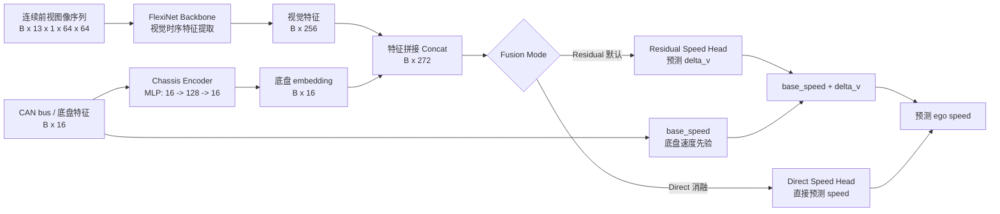

# FlexiNet_ChassisFusion 老师汇报材料

## 1. 汇报标题和整体定位

**建议标题：**  
**基于 FlexiNet 视觉时序特征与 CAN Bus 底盘先验融合的 nuScenes 自车速度估计方法**

本项目不是单纯的视觉速度估计，而是一个面向 nuScenes ego vehicle speed estimation 的多模态融合项目。视觉侧使用已经汇报过的 FlexiNet 作为时序视觉特征提取器；底盘侧引入 CAN bus 中的车辆速度、轮速、加速度、横摆角速度、转向、油门、刹车等车辆自身运动状态信息；最终通过特征融合与残差修正实现更稳定、更准确的自车速度估计。

本次汇报不重复展开 FlexiNet 内部结构。报告中将 FlexiNet 视为一个输入连续前视图像序列、输出 256 维视觉时序特征的 backbone，重点说明：为什么融合底盘数据、如何构造底盘特征、如何做 residual fusion、训练与评估如何设计，以及实验结果说明了什么。

## 2. 报告大纲

1. **项目定位与问题背景**：从纯视觉速度估计的局限引出底盘融合。
2. **任务定义**：输入连续前视图像序列和同步底盘特征，输出中心帧附近自车速度。
3. **数据与样本构造**：图像序列、16 维底盘特征、base_speed 先验、速度标签和时间对齐逻辑。
4. **算法总体结构**：FlexiNet 视觉分支、chassis encoder 底盘分支、特征拼接、速度回归头。
5. **残差融合机制**：`predicted_speed = base_speed + learned_delta_v`。
6. **模型模块与训练策略**：冻结视觉骨干、训练融合头、损失函数、优化器、学习率策略、checkpoint。
7. **评估指标与实验结果**：MAE、RMSE、R2，与 base_speed baseline 的定量对比。
8. **可视化图表解读**：趋势图、散点图、残差图、误差直方图、速度段 MAE、训练曲线。
9. **技术亮点、局限与后续工作**。
10. **总结与答疑准备**。

## 3. 研究动机与问题定义

纯视觉速度估计的优势是可以从连续图像中捕捉道路纹理、场景流动、前方物体相对运动和时序变化。但它也容易受到外界环境影响，例如光照变化、雨雾天气、动态物体遮挡、纹理缺失、低速场景中视觉位移不明显、夜间图像质量下降等。对于车辆速度估计来说，如果只依赖视觉分支，模型需要同时学习环境感知、运动线索提取和速度回归，学习难度较高。

底盘 CAN bus 数据提供的是车辆自身运动状态，物理意义更直接。例如车速、轮速、纵向加速度、横向加速度、横摆角速度、方向盘角、油门和刹车等，都与车辆真实运动状态直接相关。底盘信号通常能给出很强的速度先验，但它也不是绝对可靠的：可能存在传感器噪声、时间延迟、低速或打滑状态下轮速误差、局部缺失、不同 CAN 消息频率不一致等问题。

因此，本项目的核心思路是：**视觉分支提供外部环境和时序运动线索，底盘分支提供自车运动状态先验；模型不再从零估计速度，而是在底盘速度先验基础上学习视觉辅助的误差修正。**

任务定义为：给定一段连续前视相机图像序列和与中心帧时间戳对齐的底盘 CAN bus 特征，估计中心帧附近 ego vehicle 的速度。代码中速度标签由中心帧 ego pose 到下一帧 ego pose 的平面位移除以时间间隔得到，单位为 m/s。

需要说明的边界：CAN bus 特征选择严格使用 `utime <= center_timestamp` 的消息，不使用中心时间之后的 CAN 信息；但视觉输入是以中心帧为中心的 13 帧窗口，包含中心帧之后的图像。因此当前实验更准确地表述为“中心帧附近速度估计”，而不是严格在线因果推理。

## 4. 数据输入与样本构造

### 4.1 视觉输入

实际代码来自 `dataset/nuscenes_chassis.py` 和 `configs/default.yaml`。

- 相机通道：`CAM_FRONT`。
- 序列长度：`seq_len = 13`。
- 中心帧：`center_idx = seq_len // 2 = 6`。
- 图像尺寸：`64 x 64`。
- 通道数：灰度单通道。
- 单样本视觉张量：`[T, 1, H, W] = [13, 1, 64, 64]`。
- batch 后输入模型：`[B, 13, 1, 64, 64]`。
- 图像预处理：Resize、Grayscale、ToTensor、Normalize(mean=0.5, std=0.5)。

### 4.2 底盘输入

底盘输入为 16 维向量，来自 `NuScenesCanBusAdapter.extract_feature_vector()`。特征顺序如下：

| 维度 | 特征名 | 物理含义 |
|---:|---|---|
| 0 | `vehicle_speed` | vehicle_monitor 中的车辆速度，代码中由 km/h 转为 m/s |
| 1 | `odom_speed` | 轮速/里程计速度，代码中由 km/h 转为 m/s |
| 2 | `pose_speed` | CAN pose 速度向量的平面模长 |
| 3 | `yaw_rate` | 横摆角速度，代码中转为 rad/s |
| 4 | `throttle` | 油门开度，按 1000 归一化 |
| 5 | `brake` | 刹车量，按 126 归一化 |
| 6 | `steering` | 转向输入，按 780 归一化 |
| 7 | `steering_feedback` | 转向反馈，按 7.7 归一化 |
| 8 | `longitudinal_accel` | 纵向加速度 |
| 9 | `transversal_accel` | 横向加速度 |
| 10 | `wheel_speed_mean` | 四轮轮速均值 |
| 11 | `wheel_speed_std` | 四轮轮速标准差，可反映轮间不一致 |
| 12 | `accel_x` | pose 中 x 方向加速度 |
| 13 | `accel_y` | pose 中 y 方向加速度 |
| 14 | `rotation_rate_z` | z 轴旋转角速度 |
| 15 | `base_speed` | 底盘速度先验 |

底盘速度先验 `base_speed` 的代码优先级为：先使用 `vehicle_speed`；如果当前 base_speed 为 0 且存在轮速消息，则使用 `odom_speed`；如果仍为 0 且存在 pose 消息，则使用 `pose_speed`；否则为 0。汇报时可简化为 `vehicle_speed -> odom_speed -> pose_speed -> 0`。但严谨地说，代码以“当前值是否等于 0”为 fallback 条件，因此真实静止状态下如果后续信号非零，可能会触发替代。

### 4.3 速度标签

目标速度 `speed` 不是直接取 CAN bus 速度，而是由 nuScenes ego pose 构造：

1. 取中心相机帧 `center_token` 的 ego pose。
2. 取下一相机帧 `next_token` 的 ego pose。
3. 计算两帧之间 x-y 平面位移：
   `distance = sqrt((x2-x1)^2 + (y2-y1)^2)`。
4. 计算时间差：
   `dt = (timestamp2 - timestamp1) / 1e6`。
5. 得到速度标签：
   `target_speed = distance / dt`。

这样做的好处是标签来自全局 ego pose 位移，与作为模型输入的 CAN 速度先验相互独立，便于评估模型是否真正改善了底盘速度先验。

### 4.4 时间对齐与未来信息

CAN bus 消息通过 `_select_latest_before()` 对齐：对每类消息按 `utime` 排序，并选择满足 `utime <= center_timestamp` 的最新一条。因此底盘特征不会使用中心时刻之后的 CAN 信息。不同 CAN 消息源包括 `pose`、`vehicle_monitor`、`zoe_veh_info` 和 `steeranglefeedback`。

需要在答辩中主动说明：CAN 分支是无未来信息的；视觉分支当前使用中心窗口，包含中心帧之后图像。如果后续要部署在线系统，应改成只使用中心帧及其历史帧，或者明确任务是离线/后处理速度估计。

## 5. 算法总体结构

整体 pipeline 如下：

1. 图像序列输入 FlexiNet backbone，输出 256 维视觉时序特征。
2. 16 维底盘向量输入 chassis encoder，映射为 16 维底盘 embedding。
3. 将视觉特征和底盘 embedding 拼接，得到 272 维融合特征。
4. residual 模式下，融合特征经过残差速度头输出 `delta_v`。
5. 最终预测速度为 `base_speed + delta_v`。

FlexiNet 在这里的角色是视觉时序特征提取器，不是完整的单模态速度估计器。原始 FlexiNet 的速度回归头没有作为主线保留；加载预训练权重时，代码只筛选视觉 backbone 相关模块权重。

### Mermaid 算法结构图



## 6. 融合机制重点分析

### 6.1 residual fusion

项目默认采用 residual fusion：

```text
predicted_speed = base_speed + learned_delta_v
```

其中 `base_speed` 是底盘 CAN bus 提供的速度先验，`learned_delta_v` 是模型从视觉特征和底盘特征中学习到的修正量。也就是说，模型不是从零回归速度，而是在一个物理上较可信的速度初值上做误差补偿。

这种设计有四个优点：

1. **符合车辆运动物理先验**：车辆速度本来就可以由底盘传感器给出较强估计。
2. **降低学习难度**：模型只需要学习 `base_speed` 与 pose 标签之间的差异，而不是完整速度值。
3. **提高训练稳定性**：当底盘速度已经较可靠时，最优修正量往往是小幅修正，回归目标更平滑。
4. **让视觉信息作用更明确**：视觉分支主要用于修正底盘先验在特定场景下的偏差，例如时间对齐误差、低速状态、加减速变化或轮速局部不稳定。

当前测试集中，`delta_v = pred_speed - base_speed` 的均值约为 0.0947 m/s，标准差约为 0.2226 m/s，范围约为 -1.2207 到 1.1644 m/s。这说明模型总体上是在底盘先验附近做修正，而不是完全脱离底盘速度重新估计。

### 6.2 direct fusion

direct fusion 使用同样的视觉特征和底盘 embedding 拼接，但直接通过回归头预测速度：

```text
predicted_speed = fusion_head([visual_feature, chassis_feature])
```

direct 模式的优点是形式更自由，不强制模型围绕 `base_speed` 修正；缺点是没有显式利用底盘速度作为强先验，回归难度更高，也不如 residual 模式容易解释。对于本项目，CAN bus 已经能提供较可靠的速度先验，因此汇报主线推荐使用 residual fusion。direct fusion 更适合作为后续消融实验，与 base_speed baseline 和 residual fusion 做三组对比。

## 7. 模型模块分解

实际模型 `FlexiNetChassisFusion` 包含以下模块：

| 模块 | 代码位置 | 功能 |
|---|---|---|
| FlexiNet backbone | `model/flexinet_backbone.py` | 将 `[B,13,1,64,64]` 图像序列编码为 `[B,256]` 视觉特征 |
| ChassisEncoder | `model/fusion_model.py` | 将 16 维底盘特征映射为 16 维 embedding |
| FusionHead | `model/fusion_model.py` | 两层 MLP + dropout，用于速度回归 |
| residual_speed_head | `model/fusion_model.py` | residual 模式下预测 `delta_v` |
| direct_speed_head | `model/fusion_model.py` | direct 模式下直接预测速度 |

默认配置中 `freeze_backbone: true`，即训练时冻结 FlexiNet 视觉骨干，只训练底盘编码器和融合回归头。这样设计的原因是：

1. 保留原始 FlexiNet 预训练得到的视觉时序特征。
2. 减少训练参数量，降低小数据或中等规模数据下过拟合风险。
3. 提高训练稳定性，避免新任务训练破坏原有视觉表征。
4. 降低训练成本和显存开销。

如果后续验证冻结训练已经稳定，可以再尝试解冻 backbone，并对 backbone 使用更小学习率。

## 8. 训练策略与实验设置

默认实验配置如下：

| 类别 | 参数 | 默认值 |
|---|---|---|
| 数据版本 | `version` | `v1.0-trainval` |
| 训练/验证划分 | train.py | train split / val split |
| 相机 | `cam_channel` | `CAM_FRONT` |
| 图像序列长度 | `seq_len` | 13 |
| 图像大小 | `img_height`, `img_width` | 64, 64 |
| 底盘输入维度 | `chassis_input_dim` | 16 |
| 底盘 embedding 维度 | `chassis_feature_dim` | 16 |
| 融合特征维度 | visual 256 + chassis 16 | 272 |
| 隐藏层维度 | `hidden_dim` | 128 |
| Dropout | `dropout` | 0.3 |
| 融合模式 | `fusion_mode` | residual |
| 冻结视觉骨干 | `freeze_backbone` | true |
| batch size | `batch_size` | 16 |
| epoch | `epochs` | 10 |
| head 学习率 | `learning_rate_head` | 0.001 |
| backbone 学习率 | `learning_rate_backbone` | 0.00003 |
| weight decay | `weight_decay` | 0.0001 |
| loss | `loss` | SmoothL1Loss |
| AMP | `use_amp` | true |
| 梯度裁剪 | `grad_clip` | 2.0 |
| 随机种子 | `seed` | 42 |

损失函数默认使用 Smooth L1，也可理解为 Huber 型回归损失。它比 MSE 对异常误差更稳健，同时比纯 L1 在小误差区域更平滑，适合速度回归任务。

优化器使用 AdamW。参数分为 head 参数组和 backbone 参数组，虽然默认冻结 backbone，但代码仍保留 backbone 学习率配置，便于后续解冻微调。学习率调度器为 CosineAnnealingLR，按 epoch 更新。AMP 仅在 CUDA 可用且配置开启时使用。训练中使用 `clip_grad_norm_` 做梯度裁剪，最大范数为 2.0。

checkpoint 逻辑为：每个 epoch 保存 `checkpoints/last.pth`；当验证 loss 优于历史最优时保存 `checkpoints/best.pth`。训练过程会写出 `training_history.csv/json`、训练曲线、验证诊断图和紧凑版 `results_git` 结果。

## 9. 评估指标与结果分析

### 9.1 指标含义

- **MAE**：平均绝对误差，单位 m/s 或 km/h，反映平均偏差，直观稳定。
- **RMSE**：均方根误差，对大误差更敏感，可反映是否存在较严重 bad case。
- **R2**：决定系数，反映预测值解释真实速度变化的能力，越接近 1 越好。
- **base_speed baseline**：直接使用底盘速度先验作为预测结果，不经过视觉融合模型。它是判断融合是否有效的关键基线。
- **gain vs base**：baseline 误差减去模型误差。该值为正，说明融合模型优于直接使用底盘速度。

### 9.2 当前测试结果

结果来自 `outputs/FlexiNet_ChassisFusion/eval/val_metrics.json` 与 `results_git/FlexiNet_ChassisFusion/test_eval/val_metrics.json`，两者一致。逐样本统计来自 `outputs/FlexiNet_ChassisFusion/eval/val_predictions.csv`，共 33,148 个样本。

| 方法 | MAE (m/s) | MAE (km/h) | RMSE (m/s) | RMSE (km/h) | R2 | 相对 base 的变化 |
|---|---:|---:|---:|---:|---:|---|
| base_speed baseline | 0.1995 | 0.7180 | 0.2813 | 1.0126 | 0.9936* | 直接使用底盘先验 |
| FlexiNet + Chassis residual fusion | 0.0895 | 0.3223 | 0.1246 | 0.4485 | 0.9987 | MAE 降低 0.1099 m/s，RMSE 降低 0.1567 m/s |

说明：baseline 的 R2 是根据预测 CSV 额外计算得到，原始 metrics JSON 只保存模型 R2。

从结果看，融合模型显著优于直接使用 `base_speed`。MAE 从 0.1995 m/s 降到 0.0895 m/s，约降低 55.1%；RMSE 从 0.2813 m/s 降到 0.1246 m/s，约降低 55.7%。换成 km/h，平均误差从 0.7180 km/h 降到 0.3223 km/h，更直观地说明融合模型把误差压到了很小范围。

### 9.3 不同速度段结果

| 真实速度段 (m/s) | 样本数 | base MAE (m/s) | 模型 MAE (m/s) | 提升 (m/s) | 解读 |
|---|---:|---:|---:|---:|---|
| 0-2 | 7,709 | 0.0891 | 0.0339 | 0.0551 | 低速段误差本来较小，模型继续压低误差 |
| 2-5 | 6,808 | 0.2638 | 0.1077 | 0.1561 | 提升最明显，说明视觉与底盘融合对常见低中速很有效 |
| 5-10 | 15,771 | 0.2193 | 0.1056 | 0.1137 | 样本最多的速度段稳定优于 baseline |
| 10-15 | 2,860 | 0.2343 | 0.1074 | 0.1269 | 较高速段仍有明显收益 |
| 15+ | 0 | - | - | - | 当前验证/测试输出中没有该速度段样本 |

结论是：融合模型不是只在某个局部速度段有效，而是在当前有样本的 0-15 m/s 区间内均优于 base_speed baseline。

## 10. 图表解读建议

### 10.1 真值与估计值综合对比图

文件：`results_git/FlexiNet_ChassisFusion/test_eval/val_true_vs_estimated_comparison.svg`

这张图适合放在结果页作为总览图。它展示验证集样本顺序下真实速度、模型估计速度及误差趋势。横轴通常是样本序号或下采样后的样本序列，纵轴是速度或误差。汇报时重点观察模型曲线是否跟随真实速度变化，以及误差是否大部分围绕 0 附近波动。它能支撑“模型整体跟踪速度变化较好”的结论，也可能暴露某些片段存在连续偏高或偏低。

### 10.2 局部放大趋势图

文件：`results_git/FlexiNet_ChassisFusion/test_eval/val_true_vs_estimated_zoom_first1000.svg`

这张图展示前 1000 个验证样本的局部趋势，通常包含真实速度、模型估计和 base_speed。横轴是样本序号，纵轴是速度 m/s。汇报时可以指出：局部放大图比全局图更容易看出模型是否贴近真值，以及相比 base_speed 是否更平滑、更接近目标速度。它适合证明 residual correction 不是只改善平均指标，而是在连续片段中也能更好跟随速度变化。

### 10.3 预测值与真实值散点图

文件：`results_git/FlexiNet_ChassisFusion/test_eval/val_pred_vs_target.png`

横轴是真实速度 `target_speed_mps`，纵轴是预测速度。图中同时画出模型预测点、base_speed 点和理想对角线。点越接近对角线，说明估计越准确。汇报时应重点比较模型点云与 base_speed 点云谁更贴近对角线。如果模型点更集中在对角线附近，就说明融合模型对底盘先验进行了有效校正。

### 10.4 残差随速度变化图

文件：`results_git/FlexiNet_ChassisFusion/test_eval/val_residual_vs_speed.png`

横轴是真实速度，纵轴是预测残差 `pred_speed - target_speed`。理想情况是残差围绕 0 分布，没有明显随速度增大而系统偏高或偏低。汇报时可以用它分析模型是否存在速度相关偏差：如果高速度段残差持续为正，说明高估；持续为负，说明低估。该图能帮助老师看到模型误差不是只看单个平均数，而是有诊断分析。

### 10.5 绝对误差直方图

文件：`results_git/FlexiNet_ChassisFusion/test_eval/val_abs_error_histogram.png`

横轴是绝对误差 `abs(pred_speed - target_speed)`，纵轴是样本数量。柱子越集中在左侧，说明多数样本误差较小。当前逐样本统计中，模型绝对误差中位数约为 0.0671 m/s，而 base 绝对误差中位数约为 0.1512 m/s。汇报时可说明模型不仅平均误差更低，多数样本的典型误差也更低。

### 10.6 残差修正量分布图

文件：`results_git/FlexiNet_ChassisFusion/test_eval/val_delta_v_histogram.png`

横轴是 `delta_v = pred_speed - base_speed`，纵轴是样本数量。这张图专门解释 residual fusion：如果 `delta_v` 大多集中在 0 附近，说明模型主要进行小幅校正；如果分布很宽或有明显长尾，可能说明底盘先验不稳定或模型过度修正。当前 `delta_v` 均值约 0.0947 m/s，标准差约 0.2226 m/s，可解释为模型多数情况下围绕底盘先验做有限幅度补偿。

### 10.7 不同速度段 MAE 对比图

文件：`results_git/FlexiNet_ChassisFusion/test_eval/val_speed_bin_mae.png`

横轴是真实速度分段，纵轴是 MAE，柱状图比较 base_speed 和模型。它最适合回答“模型在哪些速度段有效”。当前结果中，0-2、2-5、5-10、10-15 m/s 四个有样本的速度段均优于 baseline，说明融合收益具有较好的速度段覆盖。

### 10.8 训练 / 验证 loss 曲线

文件：`results_git/FlexiNet_ChassisFusion/train_val_loss_curve.png`

横轴是 epoch，纵轴是 loss，展示训练 loss 和验证 loss。它用于说明训练是否收敛、验证 loss 是否明显反弹。根据 `training_history.csv`，验证 loss 从第 1 个 epoch 的约 0.0176 降到第 10 个 epoch 的约 0.00776，总体下降，说明训练过程有效。

### 10.9 验证 MAE / RMSE 曲线

文件：`results_git/FlexiNet_ChassisFusion/val_mae_rmse_curve.png`

横轴是 epoch，纵轴是速度误差 m/s，展示验证 MAE、RMSE 和 base MAE。该图用于说明模型训练过程中是否逐步超过底盘 baseline。根据历史记录，验证 MAE 从 0.1372 m/s 降到 0.0895 m/s，且始终低于 base MAE 0.1995 m/s；后期提升更明显，说明融合头逐步学习到有效修正。

## 11. 8-12 页 PPT 建议结构

| 页码 | 标题 | 核心内容 | 建议图表 |
|---:|---|---|---|
| 1 | 项目定位 | FlexiNet 视觉时序特征 + CAN bus 底盘先验的多模态速度估计；本次不展开 FlexiNet 内部 | 一句话 pipeline 图 |
| 2 | 问题动机 | 纯视觉受环境影响，底盘信号有物理意义但有噪声和延迟；融合二者互补 | 视觉/底盘优缺点对比表 |
| 3 | 任务定义与数据输入 | 输入 13 帧前视灰度图 + 16 维底盘特征，输出中心帧附近速度 | 数据流示意 |
| 4 | 样本构造与时间对齐 | ego pose 速度标签；CAN 取 `utime <= center_timestamp`；base_speed 来源 | 时间轴图 |
| 5 | 算法总体结构 | FlexiNet backbone、chassis encoder、concat fusion、速度头 | Mermaid 结构图 |
| 6 | Residual Fusion | `pred = base_speed + delta_v`；为什么比 direct 更适合作主线 | 公式 + delta_v 分布图 |
| 7 | 训练设置 | 冻结 backbone、SmoothL1、AdamW、CosineAnnealingLR、AMP、grad clip、checkpoint | 配置表 + loss 曲线 |
| 8 | 定量结果 | MAE/RMSE/R2；与 base_speed baseline 对比；约 55% 误差降低 | 结果表 |
| 9 | 诊断图分析 | 散点图、速度段 MAE、残差图说明模型在哪些情况有效 | `val_pred_vs_target.png` 和 `val_speed_bin_mae.png` |
| 10 | 总结与展望 | 技术亮点、局限、后续 direct/residual 消融、visual-only/chassis-only 对比、时序底盘建模 | 亮点和后续工作列表 |

## 12. 8-10 分钟汇报讲稿

各位老师好，我今天汇报的是 FlexiNet_ChassisFusion 项目。这个项目面向 nuScenes 自车速度估计任务，核心思想不是单纯用视觉估计速度，而是在 FlexiNet 视觉时序特征的基础上，引入 CAN bus 底盘动力学和运动学特征，通过多模态融合来获得更稳定、更准确的 ego vehicle 速度估计。由于 FlexiNet 的内部结构之前已经单独汇报过，所以今天我不再展开 FlexiNet 的内部模块，而是把它作为视觉时序特征提取器，重点说明底盘数据为什么要融合、怎么融合、训练和评估怎样设计，以及实验结果说明了什么。

首先看研究动机。纯视觉速度估计的优点是可以从连续图像里看到场景运动、道路纹理变化、前方目标相对运动等信息。但是纯视觉方法也有明显局限，例如光照变化、遮挡、雨雾天气、动态物体干扰、纹理缺失、低速情况下图像位移很小等，都会影响速度回归稳定性。另一方面，车辆底盘 CAN bus 数据本身具有很强的物理意义，比如车辆速度、轮速、纵向和横向加速度、横摆角速度、方向盘角、油门和刹车。这些信号直接描述车辆自身运动状态，通常能给出很强的速度先验。但 CAN bus 也不是完美的，可能存在噪声、延迟、消息缺失或者轮速局部不稳定。所以这个项目采用多模态融合：视觉提供环境和时序运动线索，底盘数据提供车辆自身运动状态先验。

任务定义是：输入一段连续前视图像序列，以及与中心帧时间戳对齐的底盘特征，输出中心帧附近 ego vehicle 的速度。默认配置中，图像来自 CAM_FRONT，序列长度是 13，灰度单通道，图像大小 64 乘 64，所以单个样本的视觉输入是 `[13, 1, 64, 64]`，batch 后是 `[B, 13, 1, 64, 64]`。速度标签不是直接取 CAN 速度，而是由 nuScenes ego pose 构造：取中心相机帧和下一相机帧的 ego pose，计算平面位移，再除以时间间隔，得到单位为 m/s 的目标速度。这样可以用 pose 位移作为监督信号，评价模型是否比底盘速度先验更接近真实运动。

底盘输入是 16 维向量，包含 vehicle_speed、odom_speed、pose_speed、yaw_rate、throttle、brake、steering、steering_feedback、longitudinal_accel、transversal_accel、wheel_speed_mean、wheel_speed_std、accel_x、accel_y、rotation_rate_z 和 base_speed。其中 base_speed 是底盘速度先验，优先来自 vehicle_speed，如果没有有效值再尝试 odom_speed 和 pose_speed。CAN bus 的时间对齐采用最新历史消息，也就是只选 `utime <= center_timestamp` 的 CAN 记录，因此底盘分支不使用中心时刻之后的 CAN 信息。这里需要补充一个边界：视觉输入是以中心帧为中心的 13 帧窗口，包含中心帧之后的图像，所以当前实验更适合表述为中心帧附近速度估计，而不是严格在线因果推理。

接下来是算法结构。图像序列进入 FlexiNet backbone，输出 256 维视觉时序特征。16 维底盘向量进入 chassis encoder，这是一个简单 MLP，把底盘特征映射到 16 维 embedding。然后把 256 维视觉特征和 16 维底盘 embedding 拼接成 272 维融合特征，再送入速度回归头。这里 FlexiNet 的作用是视觉特征提取器，不是单独的单模态速度估计器。加载预训练权重时，代码只加载 FlexiNet backbone 相关权重，原始速度回归头没有作为主线保留。

本项目最重要的融合机制是 residual fusion，公式是 `predicted_speed = base_speed + learned_delta_v`。也就是说，模型不是从零预测速度，而是在 CAN bus 给出的底盘速度先验上学习一个修正量。这样设计的好处是非常直接的：第一，它符合车辆运动的物理先验，因为底盘速度本来就是强相关信号；第二，它降低了回归学习难度，模型只需学习 base_speed 和 pose 标签之间的误差；第三，当底盘信号较可靠时，模型只需要做小幅补偿，训练更稳定；第四，视觉信息的作用更清晰，主要用于修正底盘先验中的偏差。代码中也支持 direct fusion，也就是从拼接特征直接预测速度，但考虑到 CAN bus 已经提供了强先验，本次汇报把 residual 作为主线，direct 更适合作为后续消融实验。

训练策略方面，默认配置冻结 FlexiNet backbone，只训练 chassis encoder 和融合回归头。这样可以保留预训练视觉特征，降低过拟合风险，也减少训练成本。训练使用 SmoothL1Loss，它比 MSE 对异常值更稳健，又比 L1 在小误差区域更平滑。优化器是 AdamW，学习率 head 为 0.001，backbone 为 0.00003，虽然默认冻结 backbone，但代码保留了解冻微调接口。学习率调度采用 CosineAnnealingLR，AMP 在 CUDA 上开启，梯度裁剪阈值为 2.0。训练 10 个 epoch，每个 epoch 保存 last checkpoint，验证 loss 最优时保存 best checkpoint。

评估方面，除了模型自身的 MAE、RMSE 和 R2，最关键的是和 base_speed baseline 对比。base_speed baseline 指不经过融合模型，直接用底盘速度先验作为估计结果。如果融合模型不能超过这个 baseline，就说明视觉融合没有带来实际价值。当前测试结果来自 `test.py` 对 best checkpoint 的评估，共 33,148 个验证样本。模型 MAE 是 0.0895 m/s，也就是 0.3223 km/h；RMSE 是 0.1246 m/s，也就是 0.4485 km/h；R2 是 0.9987。相比之下，base_speed baseline 的 MAE 是 0.1995 m/s，也就是 0.7180 km/h；RMSE 是 0.2813 m/s，也就是 1.0126 km/h。也就是说，融合模型把 MAE 降低了 0.1099 m/s，约 55.1%；RMSE 降低了 0.1567 m/s，约 55.7%。这说明视觉和底盘融合确实优于直接使用底盘速度先验。

从不同速度段来看，当前验证集中 0 到 15 m/s 的速度段都有样本，模型在所有有样本的速度段都优于 baseline。0-2 m/s 段，模型 MAE 为 0.0339 m/s，base 为 0.0891 m/s；2-5 m/s 段，模型 0.1077 m/s，base 0.2638 m/s；5-10 m/s 段，模型 0.1056 m/s，base 0.2193 m/s；10-15 m/s 段，模型 0.1074 m/s，base 0.2343 m/s。这说明提升不是只出现在某个局部速度段，而是覆盖了当前验证集中主要速度范围。

可视化图表可以从三个角度讲。第一是真值和估计值趋势图，包括全局对比图和前 1000 样本局部放大图，用来说明模型速度曲线是否能跟随真实速度变化，以及是否比 base_speed 更贴近真值。第二是预测值和真实值散点图，点越靠近对角线说明越准确，可以直观看出模型点云比 base_speed 更贴近理想线。第三是诊断图，包括残差随速度变化图、绝对误差直方图、delta_v 分布图和速度段 MAE 对比图。特别是 delta_v 分布图可以解释 residual fusion 的行为：当前修正量均值约 0.0947 m/s，标准差约 0.2226 m/s，说明模型主要是在底盘先验附近进行有限幅度校正，而不是完全脱离底盘信号重新估计速度。

最后总结一下。这个项目的主要亮点是把 FlexiNet 视觉时序特征和 CAN bus 底盘运动学信息融合起来，并采用 residual correction，把底盘速度作为强先验，让模型学习相对先验的修正量。实验上不仅报告了模型自身误差，还与 base_speed baseline 做了明确对比，并提供多种诊断图分析误差来源。从当前结果看，融合模型在 MAE 和 RMSE 上都比底盘先验有约 55% 的误差下降，说明视觉信息确实对底盘速度先验进行了有效校正。后续可以进一步做 visual-only、chassis-only、多模态融合三组对比，补充 direct fusion 与 residual fusion 消融，引入时序底盘序列，或者使用 attention/gated fusion 代替简单拼接，并按场景、速度段、加减速状态和时间同步误差做更细致分析。

## 13. 技术亮点总结

1. **多模态融合方向明确**：不是单纯依赖视觉，而是把 FlexiNet 视觉时序特征与 CAN bus 底盘运动学信息结合。
2. **残差修正设计合理**：利用 `base_speed` 作为强物理先验，让模型学习 `delta_v`，降低速度回归难度。
3. **预训练视觉骨干复用**：默认冻结 FlexiNet backbone，保留预训练特征，降低训练成本和过拟合风险。
4. **评估基线设置清楚**：不仅报告模型 MAE/RMSE/R2，还明确与直接使用 `base_speed` 的 baseline 对比。
5. **诊断图比较完整**：提供散点图、残差图、误差直方图、修正量分布、速度段 MAE、训练曲线等，便于解释误差来源。
6. **工程结构清晰**：配置、数据集、模型、训练、测试和评估工具分离，便于后续做消融实验和扩展。

## 14. 局限性与后续改进

当前方法仍有一些局限：

1. **依赖 CAN bus 信号质量**：如果 vehicle_speed、wheel speed 或 pose 消息存在缺失、延迟或异常，base_speed 先验会影响最终预测。
2. **时间同步误差仍可能影响融合**：CAN 消息和相机帧频率不同，当前采用最新历史消息对齐，可能存在时间滞后。
3. **融合方式较简单**：当前主要是视觉特征和底盘 embedding concat 后回归，尚未引入 attention、gated fusion 或 uncertainty-aware fusion。
4. **视觉 backbone 默认冻结**：训练稳定，但视觉特征对底盘融合速度估计任务的适应性有限。
5. **当前视觉窗口非严格在线**：视觉序列以中心帧为中心，包含后续图像，部署在线场景时需要改成历史窗口。
6. **任务目标单一**：当前只估计速度，尚未联合估计加速度、横摆角速度等车辆状态。

后续工作建议：

1. 做 `visual-only`、`chassis-only`、`visual + chassis` 三组对比，明确每个模态的贡献。
2. 做 `direct fusion` 与 `residual fusion` 消融，验证残差先验是否稳定优于直接回归。
3. 引入时序底盘序列，不只使用中心时刻附近的单个底盘特征向量。
4. 尝试 attention fusion 或 gated fusion，让模型动态判断何时更信任视觉、何时更信任底盘。
5. 按场景、速度段、加速/减速状态、转弯状态进行误差分析。
6. 分析时间同步误差、传感器噪声和底盘信号缺失对结果的影响。
7. 在线部署方向上，将视觉输入改为只包含历史帧，并重新评估性能下降幅度。

## 15. 老师可能追问的问题与回答

**Q1：为什么不直接使用 CAN bus 的车速？**  
A：CAN bus 车速是很强的 baseline，但不是完全准确。当前结果中，直接使用 base_speed 的 MAE 是 0.1995 m/s，而融合模型 MAE 是 0.0895 m/s，误差约降低 55.1%。这说明 CAN 速度先验存在可修正偏差，视觉时序信息和其他底盘特征可以帮助补偿。

**Q2：视觉信息到底起到了什么作用？**  
A：在 residual 设计中，视觉不是从零估计速度，而是和底盘特征一起预测 `delta_v`。当 base_speed 与 pose 标签存在偏差时，视觉时序特征提供场景运动线索，帮助模型判断应该向上还是向下修正。delta_v 分布显示模型主要是在底盘先验附近做有限幅度修正。

**Q3：为什么选择 residual fusion，而不是 direct fusion？**  
A：因为底盘速度本身是强物理先验。Residual fusion 把学习目标从“完整速度”变为“相对底盘先验的误差补偿”，回归难度更低，也更容易解释。Direct fusion 可作为消融，但主线更推荐 residual。

**Q4：底盘特征是否使用了未来信息？**  
A：代码中 CAN bus 对齐只选择 `utime <= center_timestamp` 的最新消息，因此底盘分支不使用中心时刻之后的 CAN 信息。但视觉输入是中心窗口，包含中心帧之后图像，所以当前实验不是严格在线设置，而是中心帧附近速度估计。后续若面向在线部署，需要把视觉序列改成历史窗口。

**Q5：速度标签为什么不用 CAN bus，而用 ego pose？**  
A：如果标签也直接来自 CAN 速度，模型可能只是拟合输入中的同源信号。当前标签由中心帧到下一帧 ego pose 位移除以时间差得到，与 CAN 速度先验来源不同，更适合评价模型是否能校正底盘速度。

**Q6：冻结 FlexiNet backbone 会不会限制性能？**  
A：会有一定限制，但当前阶段冻结有三个好处：保留预训练视觉表征、降低过拟合风险、提高训练稳定性。后续可以在 residual 训练稳定后，以较小学习率解冻 backbone 做微调，并与冻结版本对比。

**Q7：当前模型是否真正超过了 baseline？**  
A：是的。当前测试结果中，base_speed baseline 的 MAE/RMSE 分别为 0.1995/0.2813 m/s，融合模型为 0.0895/0.1246 m/s。不同速度段 0-2、2-5、5-10、10-15 m/s 中，模型 MAE 都低于 baseline。

**Q8：为什么 R2 已经很高，还要看 MAE 和 RMSE？**  
A：速度序列本身变化范围较大时，R2 容易接近 1，但这不一定说明绝对误差足够小。车辆速度估计更关心实际误差大小，所以 MAE、RMSE 和 km/h 单位更直观。R2 用来辅助说明整体趋势拟合。

**Q9：当前结果有没有可能是模型过度依赖 base_speed？**  
A：模型确实利用 base_speed 作为强先验，这是 residual 设计的目的。但结果中模型显著优于直接使用 base_speed，说明它不是简单复制 base_speed，而是学习到了有效修正。后续可通过去掉视觉分支、去掉部分底盘特征、direct/residual 消融进一步量化各部分贡献。

**Q10：下一步最应该补哪个实验？**  
A：优先补三组对比：visual-only、chassis-only、visual+chassis residual。其次补 direct fusion 与 residual fusion 消融。这两组实验最能回答“视觉有没有贡献”和“残差设计是否必要”。

## 16. 汇报时的一句话结论

FlexiNet_ChassisFusion 的核心不是重新设计视觉 backbone，而是把 FlexiNet 视觉时序特征作为环境运动线索，把 CAN bus 底盘速度作为物理先验，通过 residual correction 学习速度修正量；当前测试结果显示，相比直接使用底盘速度先验，融合模型将 MAE 从 0.1995 m/s 降至 0.0895 m/s，说明视觉信息成功补偿了底盘先验中的误差。
