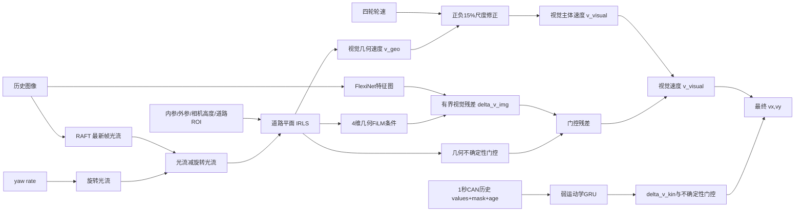
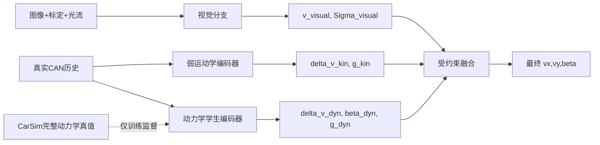
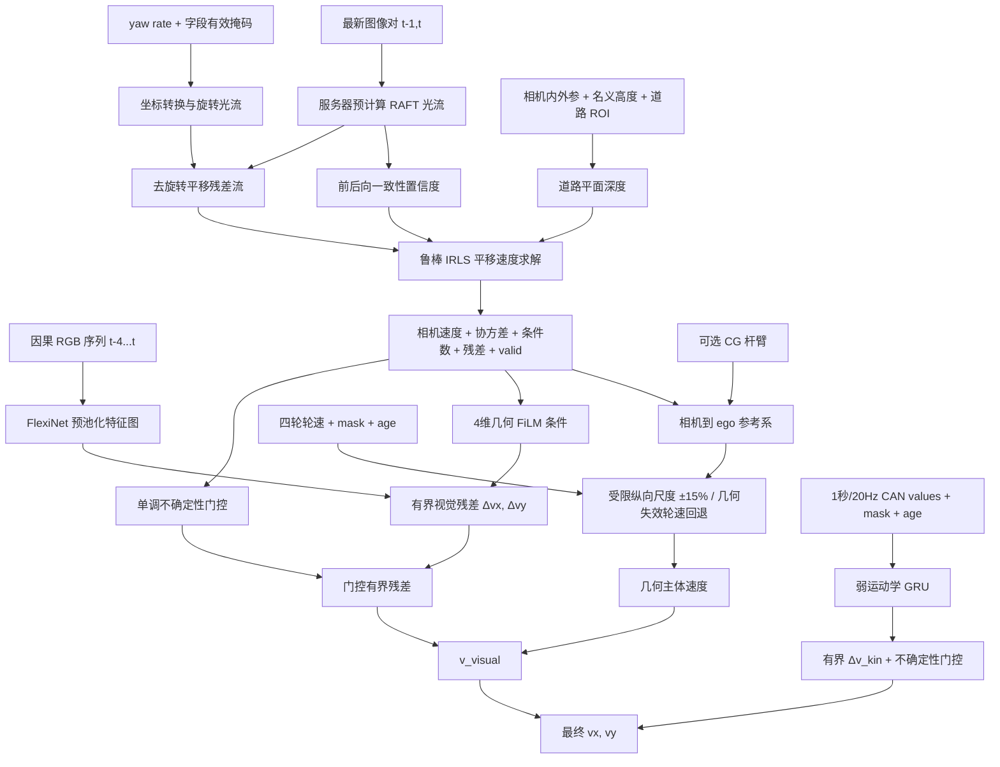
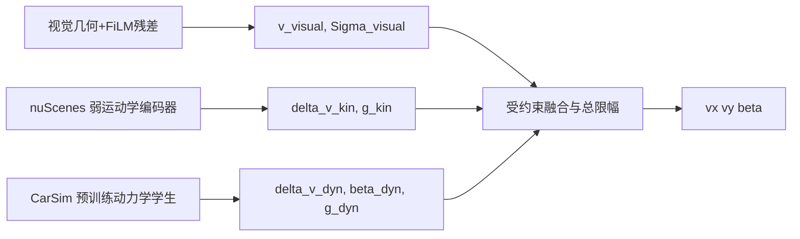

# V2 速度估计：nuScenes 数据适配、当前算法结构与 CarSim 使用建议

## 先读这一节：三分支到底是什么

### 一句话结论

**当前已经写进代码的 V2 是“视觉主分支 + 弱运动学辅助分支”，尚未包含动力学分支。**

当前代码实际是：

```text
视觉几何速度
  + 轮速受限尺度修正
  + 几何不确定性调制的视觉网络残差
  + 弱运动学时序有界修正
  = 最终 vx, vy
```

`WeakKinematicEncoder` 已实现并只使用 nuScenes 可部署 CAN 历史；由 CarSim 训练的 `DynamicsEncoder` 仍未实现，也不属于当前 nuScenes 第一阶段。

### 当前代码现在怎么计算



当前公式只有：

$$
\mathbf v_{visual}
=
\begin{bmatrix}
s_wv_{x,geo}\\v_{y,geo}
\end{bmatrix},
$$

$$
\boxed{
\hat{\mathbf v}
=\mathbf v_{visual}
+g_{img}\Delta\mathbf v_{img}
}.
$$

运动学分支进一步执行：

$$
\boxed{
\hat{\mathbf v}_{final}
=\hat{\mathbf v}
+g_{kin}\Delta\mathbf v_{kin}
}.
$$

这里：

- `v_geo`：光流道路几何算出的速度；
- `s_w`：四轮轮速提供的受限纵向尺度，只能在 `0.85-1.15` 内变化；
- `delta_v_img`：FlexiNet 根据图像输出的有界残差；
- `g_img`：由几何协方差决定的门控。
- `delta_v_kin`：弱运动学 GRU 输出的有界修正；
- `g_kin`：由字段覆盖率和预测不确定性单调控制的双轴门控。

### 当前底盘信号如何分工

| 当前底盘信号 | 当前用途 | 是否独立分支 |
|---|---|---|
| yaw rate | 生成旋转光流 | 否，只是视觉几何辅助量 |
| 四轮轮速 | 修正 `v_geo` 的纵向尺度 | 否，只是约束模块 |
| yaw/转角/`ax/ay`、踏板、轮速一致性历史 | 输入弱运动学 GRU | 是，输出 `delta_v_kin` 和 `g_kin` |
| 轮胎力、载荷、附着 | 当前 V2 没有使用 | 否，没有 `v_dyn` |

因此，当前只能画成视觉和弱运动学两个分支，不能写成视觉、运动学、动力学三个分支。

### 为什么仓库里又能看到“VKD 三分支”

仓库旧的 `velocity_xy_vkd_gated.yaml` 和 `FlexiNetChassisFusion(fusion_mode="residual_gated")` 确实包含三个并行特征分支：

```text
图像 -> FlexiNet                         -> vision feature
底盘历史 -> ChassisSequenceEncoder(GRU)  -> kinematic feature
8维底盘代理 -> DynamicsProxyEncoder(MLP) -> dynamics proxy feature
                                           |
                         softmax gate + FusionHead
                                           |
                                        vx, vy
```

但需要注意：

- 这是旧 VKD baseline，不是当前 V2 主线；
- 旧 dynamics branch 只是由 `base_velocity`、yaw、转角、`ax/ay`、轮速标准差构造的代理 MLP；
- 它没有使用 CarSim、轮胎力、载荷或附着真值；
- 三个分支通过可学习 gate 融合，缺少当前 V2 的道路几何主体和有界修正约束。

所以仓库中存在三种不同概念，不能混为一谈：

| 名称 | 当前状态 | 是否真正三分支 | 是否使用 CarSim |
|---|---|---|---|
| 旧 VKD gated baseline | 已实现、保留做对照 | 是，但动力学只是 proxy | 否 |
| 当前 V2-nuScenes | 已实现的当前主线 | 两分支 | 否 |
| 目标 V2 三分支 | 下一阶段设计 | 是 | 仅用于训练动力学学生 |

### 未来加入动力学后的完整三分支

下一阶段只需在当前两分支基础上增加动力学学生：



最终结构的计算公式建议固定为：

$$
\boxed{
\hat{\mathbf v}
=\mathbf v_{visual}
+g_{kin}\Delta\mathbf v_{kin}
+g_{dyn}\Delta\mathbf v_{dyn}
}
$$

并分别限制：

```text
delta_v_kin 有界
delta_v_dyn 有界
g_kin, g_dyn in [0,1]
底盘分支不能用一个无约束 MLP 推翻视觉主体
```

三个分支的职责是：

| 分支 | 输入 | 输出 | 解决的问题 |
|---|---|---|---|
| 视觉分支 | 图像、光流、标定、yaw 辅助 | `v_visual`、几何不确定性 | 从外部环境运动估计主体速度 |
| 弱运动学分支 | yaw、转角、`ax/ay`、轮速一致性及历史 | `delta_v_kin`、`g_kin` | 利用低参数依赖运动关系修正短时动态 |
| 动力学学生分支 | 与实车一致的 CAN 历史 | `delta_v_dyn`、`beta_dyn`、`g_dyn` | 学习轮胎、附着和强耦合工况的隐含动力学 |

### CarSim 在运行时是否存在

**不存在。CarSim 只在训练动力学学生时使用。**

```text
训练动力学学生：
  输入  = 实车将来能够得到的 CAN 信号
  监督  = CarSim 的 vx/vy/beta/轮胎力/载荷/附着等特权真值

实际推理：
  输入  = 相机 + 真实 CAN
  CarSim = 不需要
  输出  = vx, vy, beta
```

如果动力学学生训练时直接输入 CarSim 独有的真实轮胎力或附着系数，而实车推理时拿不到这些量，该分支就不能部署。

### 推荐的完整训练顺序

```text
阶段A：nuScenes
  训练/验证视觉几何主体和视觉残差

阶段B：nuScenes
  新增并训练弱运动学编码器
  输入只用真实 CAN，不用 pose 派生速度

阶段C：CarSim
  用 nuScenes 等价 CAN 信号作为动力学学生输入
  用 CarSim 完整状态作为特权监督

阶段D：回到 nuScenes
  把 CarSim 动力学学生接入 V2
  先冻结学生训练融合门，再用小学习率做域适配

阶段E：独立真实数据
  用带高精度 GNSS/INS/RTK、明确质心杆臂的实车数据最终验证
```

nuScenes 本身是真实数据，所以阶段 D 已经属于真实场景迁移和验证；但它的 `vy/beta` 和质心参考不够强。如果论文要声称高精度质心侧向速度或极限动力学能力，阶段 E 仍然需要独立的高精度实车真值。

## 1. 文档目的

本文回答三个问题：

1. nuScenes 是否能满足当前视觉、运动学和动力学速度估计方案的数据需求；
2. `FlexiNet_ChassisFusion` 修改后的 V2 算法实际是什么结构；
3. 是否需要通过 CarSim 采集底盘动力学信息，以及这些信息应该如何使用。

本文描述的是当前代码的真实能力边界，不把尚未具备的数据、标定或模块写成已经完成。

## 2. 先给结论

### 2.1 nuScenes 是否够用

**分目标判断：**

| 研究目标 | nuScenes 是否足够 | 结论 |
|---|---|---|
| 验证视觉时序网络能否估计 `vx, vy` | 基本足够 | 可作为数据驱动基线 |
| 验证道路平面视觉几何速度 | 有条件足够 | 需要核验相机高度、道路区域和光流质量 |
| 使用 yaw、转角、加速度、轮速做弱运动学辅助 | 部分足够 | CAN 信号可用，但覆盖率、延迟和语义必须审计 |
| 完整三轴旋转补偿 | 不足 | 当前公平接口只有可靠 yaw，缺少可部署的 `p, q` |
| 训练严格意义上的车辆动力学分支 | 不足 | 缺少轮胎力、法向载荷、轮端扭矩、路面附着等 |
| 输出经过验证的车辆质心速度 | 不足 | 标签是 ego-pose 参考点速度，缺少已核验质心杆臂 |
| 证明跨车辆、跨轮胎、跨附着泛化 | 不足 | nuScenes 车辆和底盘参数变化不可控、不可观测 |

因此，nuScenes 适合作为当前 **视觉几何主线和弱运动学辅助的第一阶段数据集**，但不能单独支撑“完整动力学估计器”“真实质心速度”和“跨车辆动力学泛化”等强结论。

### 2.2 当前算法属于什么结构

当前 V2 不是三个分支，而是已经完成前两个分支：

> **视觉几何与有界视觉残差主体 + 弱运动学时序有界修正。**

旧代码中的 `CausalPhysicsVelocityEstimator` 和旧融合模式仍保留为对照基线，但尚未作为独立动力学分支接入 `V2NuScenesVelocityModel`。

弱运动学编码器当前使用 1 秒、20 Hz、21 步 CAN 历史；动力学学生仍是后续 CarSim 阶段，不在当前代码中。

### 2.3 是否需要 CarSim

- 如果近期目标只是完成 nuScenes 上的 V2 几何基线和弱运动学辅助实验，**CarSim 不应阻塞当前工作**。
- 如果论文要声称“动力学辅助”“极限工况侧向速度/侧偏角估计”或“跨附着条件泛化”，**需要 CarSim 或等价高保真车辆仿真数据**。
- CarSim 独有信号应优先作为**特权监督、教师信息和受控消融真值**，不应直接成为最终模型必须依赖的输入，除非目标实车确实能够测量这些量。
- CarSim 不能替代真实数据验证。它解决可控激励和隐变量真值问题，不解决 sim-to-real 问题。

## 3. nuScenes 能提供什么

### 3.1 当前代码实际使用的数据

| 类别 | 当前使用内容 | 代码用途 |
|---|---|---|
| 前视相机 | `CAM_FRONT` 连续 RGB 图像 | 5 帧因果 FlexiNet 视觉特征 |
| 图像时间戳 | 相邻 `sample_data.timestamp` | 计算最新两帧 `dt` |
| 相机标定 | 内参、相机到 ego 外参 | 光流归一化、坐标转换 |
| 光流 | 由连续图像离线生成 | 最新一对图像的平移几何求解 |
| 横摆角速度 | `vehicle_monitor.yaw_rate` | yaw-only 旋转光流补偿 |
| 转向反馈 | `steeranglefeedback.value` | 弱运动学序列 |
| 纵/横向加速度 | `zoe_veh_info` | 弱运动学序列 |
| 四轮轮速 | `zoe_veh_info` | 受限纵向尺度修正 |
| ego pose | 前后时刻位置与姿态 | 仅生成 `[vx, vy]` 监督标签 |

nuScenes 相机标称采样率和关键帧率不应直接代替实测时间间隔。代码使用实际时间戳；正式实验还应统计每个场景的相机与 CAN 间隔分布。

### 3.2 可用但不能直接等同于所需真值的数据

#### ego pose 速度标签

当前标签通过中心时刻前后 ego pose 的位置差分获得，再旋转到中心 ego 坐标系：

$$
\mathbf v_t^e = R_{e\leftarrow g}(t)
\frac{\mathbf p_{t+1}^g-\mathbf p_{t-1}^g}
{t_{t+1}-t_{t-1}}.
$$

这能提供训练标签，但存在四个限制：

1. 它是 **ego-pose 参考点**速度，不是经过杆臂修正的质心速度；
2. 中心差分使用未来 pose，只能作为离线监督标签，不能成为在线输入；
3. 差分会放大定位噪声，尤其影响较小的 `vy`；
4. `beta = atan2(vy, vx)` 只是标签速度派生量，不是独立侧偏角传感器真值。

#### CAN 加速度与角速度

这些量可以用于弱条件化，但不能未经核验就写入严格动力学约束：

- 加速度的安装点、坐标方向、重力处理和滤波链路未完全明确；
- 当前可部署路径只可靠使用 yaw，`p/q` 被明确标记为缺失；
- CAN 报文存在异步采样、延迟、缺失和不同通道频率；
- `pose` 中的速度、加速度、旋转率可能来自定位融合链路，作为输入会造成标签捷径，因此公平模式已排除。

### 3.3 nuScenes 明确缺少或无法核验的内容

| 缺口 | 对算法的影响 |
|---|---|
| 完整原始三轴 IMU | 无法完整消除俯仰/横滚旋转流 |
| 相机相对真实质心杆臂 | 无法宣称输出真实 CG 速度 |
| GNSS/定位天线相对质心杆臂 | 标签参考点无法严格统一到 CG |
| 实测相机离地高度与在线道路法向 | 视觉公制尺度存在系统误差 |
| 轮端驱动/制动扭矩 | 无法可靠计算轮胎纵向力和滑移状态 |
| 四轮 `Fx/Fy/Fz` | 无法监督轮胎力或载荷转移分支 |
| 路面附着系数、坡度、横坡 | 无法做受控动力学工况分析 |
| 车辆质量、惯量、CG、轮胎参数变化 | 无法验证参数失配和跨车辆泛化 |
| 独立高精度 `vx/vy/beta` 真值 | 无法严格验证极限侧滑估计 |

## 4. 当前修改后算法结构

### 4.1 总体数据流



### 4.2 当前已实现算法的精确结构

本节对应当前 `model/v2/` 和 `train_v2.py`，不是未来设想。

#### 4.2.1 输入张量

当前配置下单个 batch 的主要输入为：

| 输入 | 张量形状 | 当前含义 |
|---|---|---|
| `images` | `[B, 5, 3, 72, 128]` | 当前及历史 5 帧低分辨率 RGB 图像 |
| `flow` | `[B, 2, 288, 512]` | 最新 `t-1 -> t` RAFT 光流 |
| `flow_confidence` | `[B, 1, 288, 512]` | 前后向一致性置信度 |
| `intrinsics` | `[B, 3, 3]` | 缩放到当前图像尺寸的相机内参 |
| `frame_dt` | `[B]` | 最新图像对实际时间间隔 |
| `angular_rate_camera` | `[B, 3]` | 相机系角速度；nuScenes 当前只有 yaw 对应轴有效 |
| `plane_normal_camera` | `[B, 3]` | ego 竖直方向转换到相机系后的道路法向 |
| `plane_offset` | `[B]` | 当前使用名义相机高度 `1.51 m` |
| `rotation_ego_from_camera` | `[B, 3, 3]` | 相机速度到 ego 参考系的旋转矩阵 |
| `kinematic_values` | `[B, 21, 12]` | 1秒、20 Hz 严格因果部署 CAN 值 |
| `kinematic_valid` | `[B, 21, 12]` | 逐字段有效掩码 |
| `kinematic_age` | `[B, 21, 12]` | 逐字段归一化真实消息年龄 |
| `wheel_speed` | `[B, 4]` | 四轮线速度，仅用于受限尺度 |
| `road_mask` | `[B, 1, 288, 512]` | 当前为图像高度 45% 以下的静态 ROI |

运动学每步 12 维顺序为：

```text
[yaw_rate, steering_command, steering_feedback, ax, ay,
 throttle, brake,
 wheel_residual_fl, wheel_residual_fr,
 wheel_residual_rl, wheel_residual_rr,
 wheel_speed_relative_std]
```

每个值再拼接自身 mask 和 age 后形成 `[B,21,36]` 的 GRU 输入。四轮绝对速度均值不进入该序列。

#### 4.2.2 模块 G0：离线光流

服务器上的 `precompute_v2_optical_flow.py` 使用 torchvision RAFT-Large：

```text
RGB(t-1), RGB(t)
  -> RAFT forward flow
RGB(t), RGB(t-1)
  -> RAFT backward flow
forward + warp(backward)
  -> forward/backward consistency confidence
```

RAFT 当前不在速度网络中联合训练。它是离线预处理模块，输出光流和置信度文件。

#### 4.2.3 模块 G1：旋转光流补偿

输入相机内参、角速度和 `dt`，输出：

```text
rotation_flow = RotFlow(K, omega_camera, dt)
translation_flow = raft_flow - rotation_flow
```

三轴接口支持 `[p,q,r]`，但当前 nuScenes 适配器实际设置：

```text
valid = [False, False, yaw_valid]
```

因此当前是 yaw-only 去旋转。

#### 4.2.4 模块 G2：道路平面深度

对每个道路 ROI 像素构造归一化射线：

$$
\mathbf r_i=[x_i,y_i,1]^T,
\qquad
Z_i=-\frac{d}{\mathbf n_c^T\mathbf r_i}.
$$

只有深度位于 `0.5-150 m`、光流有限且置信度大于 0 的像素进入求解。

#### 4.2.5 模块 G3：IRLS 几何速度求解

每个像素提供两个线性方程：

$$
\begin{bmatrix}
u_i/\Delta t\\
v_i/\Delta t
\end{bmatrix}
=
\begin{bmatrix}
-f_x/Z_i & 0 & f_xx_i/Z_i\\
0 & -f_y/Z_i & f_yy_i/Z_i
\end{bmatrix}
\begin{bmatrix}V_x^c\\V_y^c\\V_z^c\end{bmatrix}.
$$

当前求解参数为：

```text
IRLS iterations       = 4
Huber delta           = 1.5 px/s
minimum support       = 32 pixels
maximum condition     = 1e6
normal regularization = 1e-6
```

输出结构为：

```text
camera_velocity        [B,3]
ego_velocity           [B,2]
covariance             [B,3,3]
condition_number       [B]
residual_rms           [B]
support_count          [B]
geometry_valid         [B]
```

#### 4.2.6 模块 G4：参考系和轮速尺度

首先执行：

```text
ego_velocity_3d = R_ego_from_camera @ camera_velocity
geometry_velocity = ego_velocity_3d[:, :2]
```

当前没有 CG 杆臂，因此输出参考点保持 `ego_reference`。

四轮有效轮速求均值后只计算一个纵向尺度：

```text
wheel_scale = clip(mean_wheel_speed / abs(geometry_vx), 0.85, 1.15)
visual_vx   = wheel_scale * geometry_vx
visual_vy   = geometry_vy
```

几何无效或 `abs(geometry_vx) < 0.5 m/s` 时不应用轮速尺度。

#### 4.2.7 模块 N1：FlexiNet 视觉特征

5 帧 RGB 图像先转换为 `[B,3,5,H,W]`，再经过：

```text
ContextualMotionAnalysis:  3   -> 64 channels
AdaptiveFeatureTransformer:64  -> 128 channels
SpatialFeatureExtraction:  128 -> 256 channels
MotionFeatureExtraction:   128 -> 192 -> 256 channels
DynamicIntegrationGate:    spatial 256 + motion 256 -> integrated 256
```

当前卷积均未做空间下采样，因此预池化特征为：

```text
feature_map = [B, 256, 5, H, W]
```

当前已实现双分辨率：几何光流保持 `288x512`，FlexiNet 使用 `72x128`，其预池化特征图为 `[B,256,5,72,128]`。服务器先做 batch 8 最大显存 smoke；仅在确认 CUDA OOM 时回退到 micro batch 4，并用两步梯度累积保持有效 batch 8。

#### 4.2.8 模块 N2：4 维 FiLM 条件

几何模块额外生成 4 维上下文：

```text
[log(1 + covariance_trace),
 log(1 + condition_number),
 residual_rms,
 geometry_valid]
```

原始 CAN 不再进入 FiLM，`film_condition=[B,4]`。

FiLM 参数网络结构为：

```text
Linear(4,128) -> ReLU -> Linear(128,512)
                                   |
                       split gamma[256], beta[256]
gamma = 0.1 * tanh(gamma)
beta  = 0.1 * tanh(beta)
```

视觉特征调制：

$$
F'=F\odot(1+\gamma)+\beta.
$$

#### 4.2.9 模块 N3：有界残差头

调制特征进行全局时空池化：

```text
pool(feature_map)       -> [B,256]
concat(film_condition)  -> [B,260]
Linear(260,128) -> ReLU -> Linear(128,2) -> tanh
```

输出边界：

```text
delta_v_visual[:,0] in [-3.0, 3.0] m/s
delta_v_visual[:,1] in [-1.5, 1.5] m/s
```

#### 4.2.10 模块 N4：不确定性门控与最终输出

当前门控不是自由学习的 MLP，而是几何协方差的单调函数：

$$
g_{vis}=\sigma\left(
2\left[\log(1+\Sigma_{00}+\Sigma_{22})-0\right]
\right).
$$

几何无效时 `g_vis=1`，视觉分支输出为：

$$
\boxed{
\hat{\mathbf v}
=
\begin{bmatrix}
s_w v_{x,geo}\\v_{y,geo}
\end{bmatrix}
+g_{vis}\Delta\mathbf v_{visual}
}
$$

几何无效时，当前实现使用至少两轮有效轮速的均值构造 `[v_w,0]` 降级基准，并输出 `fallback_used=True`。

#### 4.2.11 模块 K1：弱运动学编码器与最终输出

`[B,21,12]` 的 values、mask 和 age 拼成 `[B,21,36]`，经过：

```text
Linear(36,64) -> ReLU -> Linear(64,64) -> ReLU
GRU(input=64, hidden=128)
```

两个输出头分别生成：

```text
delta_v_kin: tanh bound [1.0,0.5] m/s
log_variance_kin: clamp [-6,4]
g_kin = field_coverage * sigmoid(-log_variance_kin)
```

最终执行总限幅修正：

$$
\Delta\mathbf v_{kin,applied}
=\mathbf b_{kin}\odot\tanh\left(
\frac{g_{kin}\Delta\mathbf v_{kin}}{\mathbf b_{kin}}
\right),
$$

$$
\boxed{
\hat{\mathbf v}_{final}
=\mathbf v_{visual}
+\Delta\mathbf v_{kin,applied}
}.
$$

当前仍没有跨样本的“最近有效视觉状态”传播；轮速降级只解决纵向可用性，不提供失效期间的侧向状态传播。

### 4.3 因果数据适配层

`V2NuScenesDatasetAdapter` 强制 `online_mode=True`：

- FlexiNet 只读取当前时刻及历史图像；
- 几何模块只使用 `t-1 -> t` 光流；
- CAN 取当前及历史查询点，不使用未来报文；
- 标签可以离线使用未来 pose 做中心差分，但未来 pose 不进入模型；
- 每个底盘字段都带 `value`、`valid` 和 `age` 语义。

当前 CAN 适配器已返回各消息相对查询时刻的真实报文年龄，并按字段写入序列。该年龄仍是数据记录时间戳差，不等于传感器内部采集、总线传输和记录链路的端到端延迟。

### 4.4 视觉旋转补偿

相机角速度为：

$$
\boldsymbol\omega_c = R_{c\leftarrow e}\boldsymbol\omega_e.
$$

当前 nuScenes 路径构造：

$$
\boldsymbol\omega_e=[0,0,r]^T,
$$

并将 `p/q` 的有效掩码设为 `False`。算法接口支持三轴角速度，但当前数据实际运行的是 yaw-only 补偿。

由内参和角速度计算旋转光流：

$$
\mathbf u_{trans}=\mathbf u_{RAFT}-\mathbf u_{rot}.
$$

### 4.5 道路平面公制几何速度

使用相机坐标系道路平面：

$$
\mathbf n_c^T\mathbf X+d=0,
$$

对像素射线 `r=[x,y,1]^T` 计算深度：

$$
Z=-\frac{d}{\mathbf n_c^T\mathbf r}.
$$

当前 `d` 来自名义相机高度 `1.51 m`，道路区域为图像下方静态 ROI。它们都不是已经验证的最终值。

平移光流建立线性系统：

$$
\mathbf b=A\mathbf v_c,
$$

通过 Huber IRLS 求相机三维平移速度，并输出：

- `camera_velocity`；
- 几何协方差；
- 正规矩阵条件数；
- 鲁棒残差 RMS；
- 有效支持点数；
- `geometry_valid`。

支持点不足、条件数过大、时间间隔非法或数据非有限时，几何解会被显式判为无效。

### 4.6 参考点转换与轮速约束

相机速度先通过外参转换到 ego 参考系。只有显式提供杆臂时，才执行：

$$
\mathbf v_{CG}=\mathbf v_{ref}-\boldsymbol\omega\times\mathbf r_{ref/CG}.
$$

当前配置为 `ego_reference`，不执行 CG 修正。

轮速不进入无约束回归头。它只允许在几何有效且纵向速度足够大时，对 `vx` 做：

$$
s_w=\operatorname{clip}
\left(\frac{\bar v_w}{|v_{x,geo}|},0.85,1.15\right),
\qquad
v_{x,visual}=s_w v_{x,geo}.
$$

### 4.7 FiLM 有界视觉残差

FlexiNet 输出池化前二维时空特征图。FiLM 条件由以下量组成：

- yaw rate；
- 转向反馈；
- 纵向加速度；
- 横向加速度；
- 上述四个字段的有效掩码；
- 几何协方差摘要；
- 条件数；
- 几何残差；
- 几何有效性。

四轮绝对轮速不进入 FiLM 条件，避免网络通过轮速直接查表预测最终速度。

残差被限制为：

$$
|\Delta v_x|\le 3.0\ \mathrm{m/s},
\qquad
|\Delta v_y|\le 1.5\ \mathrm{m/s}.
$$

最终输出为：

$$
\hat{\mathbf v}
=\mathbf v_{visual}
+g(\Sigma_{geo},valid)\Delta\mathbf v_\theta.
$$

门控随几何不确定性单调增大，但残差幅值始终受限。

### 4.8 训练目标

当前总损失为：

$$
\mathcal L=
\mathcal L_v
+\lambda_\beta\mathcal L_\beta
+\lambda_g\mathcal L_{geo}
+\lambda_r\mathcal L_{res}.
$$

- `L_v`：按 `vx/vy` 尺度归一化的 Smooth L1；
- `L_beta`：预测速度方向与真值速度方向的包角误差，低速样本屏蔽；
- `L_geo`：只在几何有效时监督几何主体速度；
- `L_res`：约束学习残差幅值。

当前代码没有独立的 V2 运动学损失、轮胎动力学损失或 CarSim 教师损失。

## 5. 旧模型与 V2 模型的关系

仓库中同时存在两套路线：

| 路线 | 位置 | 作用 |
|---|---|---|
| 旧融合基线 | `model/fusion_model.py` | 视觉、运动学代理、旧物理估计器的对照实验 |
| 旧因果物理估计器 | `model/physics_velocity.py` | 轮速校正和弱单轨动力学的 physics baseline |
| 当前 V2 主线 | `model/v2/` | 视觉几何主体 + 受限轮速 + 有界 FiLM 残差 + 弱运动学 GRU 有界修正 |

不能把旧 `physics_residual_gated` 的存在描述为 V2 已经包含完整动力学分支。若后续需要三分支结构，应通过明确接口把运动学/动力学估计结果接入 V2，而不是再次把全部底盘量拼接进一个无约束 MLP。

## 6. 是否需要 CarSim

### 6.1 推荐判断

| 目标 | 是否现在需要 CarSim |
|---|---|
| 跑通 V2 几何主线、验证 nuScenes 基线 | 否，先完成真实数据审计 |
| 设计只使用 yaw/转角/加速度/轮速的运动学编码器 | 不强制，nuScenes 可先做 |
| 设计轮胎力、载荷转移、附着相关动力学教师 | 是 |
| 研究极限转向、制动转向耦合、低附着侧滑 | 是 |
| 证明实车部署有效 | CarSim 不够，还需要真实车辆或独立实测数据 |

### 6.2 推荐的 CarSim 角色

CarSim 最适合扮演三个角色：

1. **动力学教师**：使用 CarSim 完整状态和轮胎力生成可靠的 `vx/vy/beta`、轮胎状态和置信标签；
2. **特权监督**：学生网络输入仍限制为实车可获得的 yaw、转角、`ax/ay`、四轮轮速、踏板等，CarSim 独有信号只出现在损失侧；
3. **受控消融平台**：独立改变质量、CG、惯量、轮胎、附着、坡度、噪声和延迟，验证模型是否真的利用动力学规律。

不推荐的做法是：训练时直接输入 `Fx/Fy/Fz`、真实路面附着或无噪声质心状态，部署时再把这些输入删除或置零。这会造成严重训练/部署契约不一致。

### 6.3 建议采集的 CarSim 数据

#### 部署侧可用输入

- 转向指令与实际前轮转角；
- yaw rate，条件允许时保留完整 `p/q/r`；
- 纵横向加速度；
- 四轮角速度/线速度；
- 油门、制动压力或驱动/制动扭矩；
- 时间戳、有效掩码和模拟传感器延迟。

#### 仅训练可用的特权真值

- 质心 `vx/vy/vz` 与 `beta`；
- yaw/roll/pitch 及其角速度；
- 四轮 `Fx/Fy/Fz`、滑移率和侧偏角；
- 轮胎法向载荷与载荷转移；
- 路面附着、坡度、横坡；
- 车辆质量、惯量、CG 和轮胎模型参数。

#### 必须覆盖的工况

- 直线加速、制动和滑行；
- 正弦转向、蛇形、双移线、稳态圆周和 J-turn；
- 制动转向、驱动转向等纵横向耦合工况；
- 高低附着、分离附着、坡道和横坡；
- 传感器噪声、偏置、丢包、异步和延迟；
- 质量、CG、轮胎刚度和转动惯量变化。

数据划分应按车辆参数、附着条件和工况划分，不能只随机打散连续时间点，否则训练集与测试集几乎重复，无法证明泛化。

## 7. 当前两分支与未来动力学扩展

建议保持视觉主体，不直接回到“大拼接网络”：



### 7.1 已实现的弱运动学编码器

推荐使用当前时刻之前 `1 s`、`20 Hz` 的因果窗口：

```text
kinematic_sequence: [B, K=21, D=36]
```

每个时刻先构造 12 个部署可用值：

```text
yaw_rate
steering_command
steering_feedback
ax
ay
throttle
brake
wheel_residual_fl
wheel_residual_fr
wheel_residual_rl
wheel_residual_rr
wheel_speed_relative_std
```

其中：

$$
wheel\_residual_i=
\frac{v_{w,i}-\bar v_w}{\max(|\bar v_w|,0.5)}.
$$

12 个值分别拼接 12 个有效掩码和 12 个截断年龄，因此每个时间步为 `36` 维。四轮绝对速度均值仍留在独立尺度分支，不进入该编码器，降低直接查表预测 `vx` 的风险。

当前实现网络：

```text
per-step MLP:
  Linear(36,64) -> ReLU -> Linear(64,64) -> ReLU

causal sequence encoder:
  GRU(input=64, hidden=128, layers=1)

heads:
  z_kin          = hidden[128]
  delta_v_kin    = tanh(Linear(128,64,2)) * [1.0, 0.5] m/s
  log_var_kin    = Linear(128,2)
  field_coverage = mean(valid_mask)
  g_kin          = field_coverage * sigmoid(-log_var_kin)
```

运动学分支输出的是相对 `v_visual` 的有界修正 `delta_v_kin`，不是第二个无约束最终速度。nuScenes 没有滑移真值，当前实现没有 `slip_prob` 分类头。

### 7.2 CarSim 动力学学生

动力学学生的推理输入必须与未来实车一致。第一版可以直接复用上面的 `[B,21,36]` 部署输入协议，网络与运动学编码器分开训练、参数不共享。

推荐第一版网络：

```text
per-step MLP:
  Linear(36,64) -> SiLU -> Linear(64,64) -> SiLU

causal dynamics encoder:
  GRU(input=64, hidden=128, layers=1)

deployment heads:
  z_dyn          = hidden[128]
  delta_v_dyn    = tanh(Linear(128,64,2)) * [1.5, 1.0] m/s
  beta_dyn       = 0.35 * tanh(Linear(128,1)) rad
  log_var_dyn    = Linear(128,2)
  slip_prob_4    = sigmoid(Linear(128,4))
  g_dyn          = validity * sigmoid(gate(z_dyn, log_var_dyn))
```

CarSim 训练时额外提供、但不进入学生输入的特权监督包括：

```text
CG vx, vy, beta
four-wheel Fx, Fy, Fz
four-wheel slip ratio and slip angle
road friction and slope
vehicle mass, inertia, CG and tire parameters
```

动力学学生损失可以写为：

$$
\mathcal L_{dyn}=
\mathcal L_v
+\lambda_\beta\mathcal L_\beta
+\lambda_s\mathcal L_{slip}
+\lambda_u\mathcal L_{uncertainty}
+\lambda_r\|\Delta\mathbf v_{dyn}\|^2.
$$

它学习的是“从部署 CAN 历史推断隐含动力学状态”，而不是在推理时调用 CarSim。

CarSim 标签通常位于真实 CG。为了与 nuScenes 的 `ego_reference` 标签联合训练，必须二选一：

1. 在 CarSim 中设置一个与 nuScenes ego 参考点一致的虚拟测量点，并输出该点速度；
2. 获得真实杆臂后，把 nuScenes 和视觉几何统一修正到 CG。

在参考点统一前，不能直接把 CarSim CG `vy/beta` 与 nuScenes ego-pose 标签混为同一监督目标。

### 7.3 三分支受约束融合

视觉分支先独立形成主体速度：

$$
\mathbf v_{visual}
=
\begin{bmatrix}s_wv_{x,geo}\\v_{y,geo}\end{bmatrix}
+g_{img}\Delta\mathbf v_{img}.
$$

再加入两个辅助分支：

$$
\Delta\mathbf v_{aux}
=g_{kin}\Delta\mathbf v_{kin}
+g_{dyn}\Delta\mathbf v_{dyn}.
$$

为了防止两个分支叠加后突破各自边界，最终辅助修正再做一次总限幅：

$$
\Delta\mathbf v_{aux,bounded}
=\mathbf b_{aux}\odot
\tanh\left(
\frac{\Delta\mathbf v_{aux}}{\mathbf b_{aux}}
\right).
$$

最终输出：

$$
\boxed{
\hat{\mathbf v}
=\mathbf v_{visual}
+\Delta\mathbf v_{aux,bounded}
}.
$$

推荐第一版总辅助边界设置为可配置参数，而不是现在就固定数值；应根据 nuScenes 标签噪声、geometry-only 误差分布和 CarSim 域迁移结果确定。

若 `geometry_valid=False`，当前实现先用至少两轮有效轮速的均值构造即时回退 `[v_w,0]`，并记录 `fallback_used=True`。目标版本还需要一个跨样本的因果状态回退：

```text
last_valid_visual_velocity
  -> use yaw/ax/ay propagation to current time
  -> state_fallback_velocity
```

然后由 `state_fallback_velocity` 在轮速不可用或需要侧向传播时补充即时轮速回退。该跨样本状态回退目前尚未实现。

### 7.4 训练顺序

1. **nuScenes 数据审计**：标定、CAN 覆盖、单位、时延、标签噪声；
2. **geometry-only**：先证明旋转补偿、平面尺度和 IRLS 有效；
3. **nuScenes 弱运动学分支**：不使用 pose 派生输入；
4. **CarSim 动力学学生预训练**：只把部署 CAN 作为学生输入，使用域随机化和特权监督；
5. **回到 nuScenes 做域适配**：先冻结动力学学生，只训练输入归一化和融合门；再用小学习率解冻最后一层；
6. **受约束融合消融**：依次比较 visual、visual+kinematic、visual+dynamics、三分支完整模型；
7. **独立真实数据验证**：使用高精度 GNSS/INS/RTK 和已测杆臂，验证 CarSim 学到的状态不是仿真捷径。

## 8. 当前最优先的工作

在开始 CarSim 大规模采集前，先在服务器完成以下检查：

1. 统计 nuScenes 每个 CAN 字段的场景覆盖率、缺失率和实际采样间隔；
2. 抽检 yaw、转角、`ax/ay` 和四轮轮速的单位、符号及时间对齐；
3. 直线匀速场景核验相机高度和视觉速度尺度；
4. 转弯场景比较去旋转前后道路流残差；
5. 统计 geometry valid、条件数、支持点和残差分布；
6. 量化 ego-pose 差分标签的 `vy` 噪声和低速 `beta` 不稳定性。

这些检查如果不通过，立即增加 CarSim 数据并不能修复真实数据接口和标定问题。

## 9. 最终建议

推荐路线是：

> **先用 nuScenes 完成视觉几何主线和弱运动学编码器，再用 CarSim 训练动力学教师/学生，最后通过受约束接口接回 V2，并用真实数据做最终验证。**

因此，答案不是“nuScenes 或 CarSim 二选一”：

- nuScenes 负责真实视觉、真实 CAN 分布和真实场景验证；
- CarSim 负责可控动力学激励、不可测状态真值和参数泛化实验；
- 最终模型的推理输入必须以真实车辆可获得信号为准。
