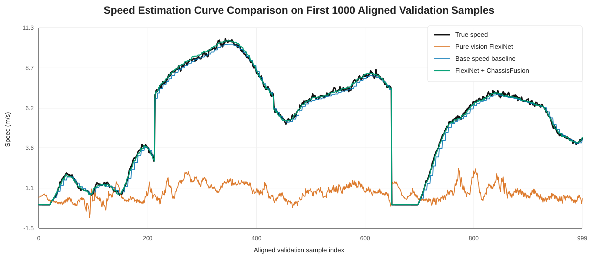
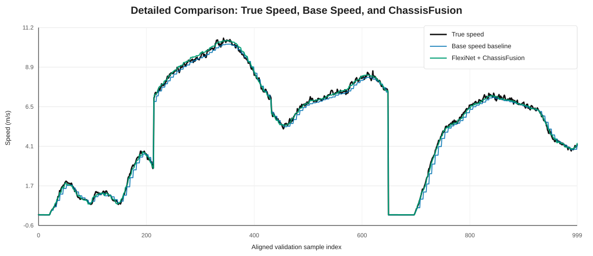

# FlexiNet 与 ChassisFusion 速度估计结果汇报

生成日期：2026-05-28项目位置：`09_SpeedChallenge_nuScenes`对比对象：

- `FlexiNet-main`：纯视觉速度估计方案。
- `FlexiNet_ChassisFusion`：融合底盘 CAN / 车辆运动学动力学信号的速度估计方案。

## 1. 核心结论

本次结果对比的核心结论是：**当前纯视觉 FlexiNet 在 nuScenes 自车速度估计任务上误差较大；引入底盘运动学 / 动力学信号后，ChassisFusion 显著降低速度估计误差，并且不仅优于纯视觉模型，也优于直接使用底盘 `base_speed` 的强 baseline。**

三组方法在同一批验证样本上完成对齐，共 `33,148` 个样本，`center_token` 完全匹配，速度标签一致，最大标签差异为 `0.0 m/s`。因此，下面的定量对比和曲线对比具有直接可比性。

| 方法                     | MAE (m/s) | MAE (km/h) | RMSE (m/s) | RMSE (km/h) |      R2 | 结论                         |
| ------------------------ | --------: | ---------: | ---------: | ----------: | ------: | ---------------------------- |
| Pure Vision FlexiNet     |    4.7097 |    16.9548 |     5.4655 |     19.6757 | -1.4172 | 当前纯视觉速度估计严重不稳定 |
| Base Speed Baseline      |    0.1995 |     0.7180 |     0.2813 |      1.0126 |  0.9936 | 底盘速度先验本身已经很强     |
| FlexiNet + ChassisFusion |    0.0895 |     0.3223 |     0.1246 |      0.4485 |  0.9987 | 融合模型进一步显著降低误差   |

相对于 `base_speed` baseline，ChassisFusion 的 MAE 从 `0.1995 m/s` 降到 `0.0895 m/s`，降低 `0.1099 m/s`，相对下降约 `55.1%`；RMSE 从 `0.2813 m/s` 降到 `0.1246 m/s`，降低 `0.1567 m/s`，相对下降约 `55.7%`。

这说明底盘速度信号确实是强先验，但融合模型不是简单复制底盘速度，而是在 `base_speed` 附近学习到了有效的误差修正。

## 2. 实验目标与对比问题

本次汇报重点不是单独说明某一份代码，而是回答速度估计任务中的三个实验问题：

1. 仅依赖前视图像序列，纯视觉 FlexiNet 能否稳定估计自车速度？
2. 直接使用底盘 `base_speed` 作为估计结果时，baseline 有多强？
3. 在强底盘先验基础上，融合视觉时序特征和底盘运动学 / 动力学信号，是否还能进一步提升精度？

对应的三组对比方法如下。

| 方法                 | 输入信息                                                          | 作用                           |
| -------------------- | ----------------------------------------------------------------- | ------------------------------ |
| Pure Vision FlexiNet | 前视相机图像序列                                                  | 检查纯视觉速度估计能力         |
| Base Speed Baseline  | 底盘 CAN 中构造出的速度先验 `base_speed`                        | 检查底盘信号本身有多强         |
| ChassisFusion        | FlexiNet 视觉特征 + 底盘运动学 / 动力学特征 + residual correction | 检查多模态融合是否带来额外收益 |

这个对比设计的关键是加入 `base_speed` baseline。因为 ChassisFusion 使用了底盘速度相关信号，如果只和纯视觉模型比较，无法判断融合模型是否只是受益于直接读取 CAN 速度。加入 `base_speed` 后，可以更严格地验证：模型是否在强底盘速度先验之上仍然产生额外改进。

## 3. 数据与评估协议

### 3.1 任务定义

任务是估计 nuScenes 中 ego vehicle 的速度。模型输入为前视图像序列，或前视图像序列加同步底盘信号；输出为中心帧附近的自车速度，单位为 `m/s`，报告中同时换算为 `km/h`。

速度标签不是直接取 CAN 中的车速，而是由 ego pose 构造：

1. 取中心相机帧对应的 ego pose。
2. 取下一相机帧对应的 ego pose。
3. 计算两帧之间的平面位移。
4. 用位移除以时间间隔，得到目标速度。

这样做的好处是，评估标签来自 ego pose 位移，与作为模型输入的底盘速度先验不是同一个量，可以用于判断融合模型是否比底盘先验更接近位姿运动得到的速度标签。

### 3.2 输入信息

纯视觉 FlexiNet 使用前视相机图像序列，主要依赖图像时序变化、道路纹理、场景运动线索和前方目标相对运动来回归速度。

ChassisFusion 在视觉分支之外加入底盘特征，包含车辆速度、轮速、pose 速度、横摆角速度、油门、制动、转向、纵横向加速度等车辆自身运动状态信息。其中 `base_speed` 是底盘速度先验，作为 residual correction 的基础速度。

需要注意的是，当前视觉输入是围绕中心帧的图像窗口，包含中心帧之后的图像。因此当前实验更准确的表述是“中心帧附近速度估计”，不是严格在线因果推理。若后续面向在线部署，需要改成只使用当前帧及历史帧。

### 3.3 评估指标

本报告使用以下指标：

- MAE：平均绝对误差，是主要指标，单位为 `m/s` 和 `km/h`。
- RMSE：均方根误差，对大误差更敏感。
- R2：决定系数，衡量预测能否解释真实速度变化。
- 误差分位数：用于观察典型误差和长尾误差。

三组方法均对齐到同一批 `33,148` 个验证样本，保证样本级别可比。

## 4. 方法概述

### 4.1 Pure Vision FlexiNet

`FlexiNet-main` 是纯视觉速度估计方案。模型从连续前视图像中提取时序视觉特征，并直接回归速度。

纯视觉方案的优点是输入简单，不依赖 CAN bus 或车辆底盘信号；理论上，它可以从图像中的光流、道路纹理变化和场景运动中学习速度。但当前结果显示，纯视觉模型在该设置下没有稳定学到速度尺度，验证集 MAE 达到 `4.7097 m/s`，R2 为 `-1.4172`。R2 为负说明其预测效果差于用均值作为预测的简单基线。

这并不等价于“纯视觉速度估计不可行”，更合理的解释是：在当前输入分辨率、训练设置、模型状态和任务定义下，纯视觉分支还没有形成可靠速度估计能力。后续需要排查 checkpoint 加载、标签尺度、归一化、训练收敛和模型输出范围等问题。

### 4.2 ChassisFusion

`FlexiNet_ChassisFusion` 在 FlexiNet 视觉时序特征的基础上，引入底盘 CAN / 车辆运动学动力学信号。其核心思路是：

1. FlexiNet backbone 提取视觉时序特征。
2. Chassis encoder 编码底盘特征。
3. 将视觉特征和底盘 embedding 拼接。
4. 使用 residual correction 输出最终速度：

```text
predicted_speed = base_speed + learned_delta_v
```

其中 `base_speed` 是底盘速度先验，`learned_delta_v` 是模型学习到的修正量。

这个设计的意义是：模型不再从零回归完整速度，而是在一个物理意义较强的底盘速度先验上学习误差补偿。这样可以降低学习难度，也更符合车辆运动状态估计的直觉。视觉特征的角色也更清晰：它不是单独承担完整速度估计，而是辅助修正底盘先验和 ego pose 速度标签之间的偏差。

## 5. 定量结果分析

### 5.1 总体误差对比

纯视觉 FlexiNet 的 MAE 为 `4.7097 m/s`，约 `16.9548 km/h`；RMSE 为 `5.4655 m/s`，约 `19.6757 km/h`。这表明当前纯视觉模型的速度估计误差较大，不适合作为最终方案。

相比之下，直接使用底盘 `base_speed` 的 baseline 已经很强：MAE 为 `0.1995 m/s`，约 `0.7180 km/h`；RMSE 为 `0.2813 m/s`，约 `1.0126 km/h`；R2 为 `0.9936`。这说明底盘速度先验与 ego pose 速度标签高度相关。

ChassisFusion 进一步将 MAE 降到 `0.0895 m/s`，约 `0.3223 km/h`；RMSE 降到 `0.1246 m/s`，约 `0.4485 km/h`；R2 达到 `0.9987`。这说明模型在强底盘 baseline 之上仍然学习到了有效修正。

### 5.2 误差分位数

除均值外，误差分位数更能反映多数样本的实际表现。

| 方法                 | P50 abs error (m/s) | P90 abs error (m/s) | P95 abs error (m/s) | P99 abs error (m/s) |
| -------------------- | ------------------: | ------------------: | ------------------: | ------------------: |
| Pure Vision FlexiNet |              4.9121 |              8.4484 |              9.1038 |             10.2974 |
| Base Speed Baseline  |              0.1512 |              0.4606 |              0.5875 |              0.8832 |
| ChassisFusion        |              0.0671 |              0.2065 |              0.2574 |              0.3694 |

可以看到，ChassisFusion 不只是降低平均误差，也显著降低了中位误差和高分位误差。中位绝对误差从 `base_speed` 的 `0.1512 m/s` 降到 `0.0671 m/s`，说明多数样本的典型误差也变小了。

### 5.3 residual correction 行为

ChassisFusion 的修正量定义为：

```text
delta_v = pred_speed - base_speed
```

当前验证集上，`delta_v` 的统计如下：

| 统计量 | 数值 (m/s) |
| ------ | ---------: |
| mean   |     0.0947 |
| std    |     0.2226 |
| min    |    -1.2207 |
| max    |     1.1644 |
| P05    |    -0.2926 |
| P95    |     0.4705 |

这说明模型大多数情况下是在 `base_speed` 附近做有限幅度修正，而不是脱离底盘速度先验重新预测速度。该行为符合 residual fusion 的设计目标：利用底盘速度提供强初值，再由视觉和其他底盘状态特征学习误差补偿。

## 6. 曲线级对比图

用户指定的两张局部曲线图：

- `FlexiNet-main/outputs/FlexiNet-main/eval/val_true_vs_estimated_zoom_first1000.svg`
- `FlexiNet-main/results_git/FlexiNet-main/test_eval/val_true_vs_estimated_zoom_first1000_2.svg`

经文件哈希检查，这两张 SVG 完全相同，是同一张图的重复保存。因此，本报告没有机械叠加两张重复图，而是使用原始 CSV 重新绘制了更有信息量的统一曲线图。

### 6.1 四曲线对比图

图文件：



该图绘制前 `1000` 个对齐验证样本上的四条曲线：

- True speed
- Pure vision FlexiNet prediction
- Base speed baseline
- FlexiNet + ChassisFusion prediction

这张图用于直观展示三类预测和真实速度之间的关系。纯视觉曲线整体明显偏离真实速度，说明其速度尺度学习失败或严重不稳定；`base_speed` 已经能够较好跟随真实速度；ChassisFusion 与真实速度更贴近，在强底盘先验基础上进一步修正误差。

### 6.2 底盘 baseline 与融合模型细节图

图文件：



因为纯视觉曲线误差较大，会压缩 `base_speed` 和 ChassisFusion 的视觉差异，所以额外绘制了只包含 True speed、Base speed 和 ChassisFusion 的细节图。该图更适合展示 residual correction 的效果：ChassisFusion 曲线整体贴近真实速度，并在局部波动上比 `base_speed` 更接近标签。

用于绘图的对齐数据保存在：

- `analysis_reports/flexinet_speed_comparison/aligned_first1000_curve_data.csv`

统计摘要保存在：

- `analysis_reports/flexinet_speed_comparison/comparison_summary.json`

## 7. 误差诊断图建议

除统一曲线图外，已有结果目录中还包含多种诊断图，建议在 PPT 或汇报附录中选择性展示。

### 7.1 Pure Vision FlexiNet 诊断图

结果目录：

- `FlexiNet-main/outputs/FlexiNet-main/eval/`

关键文件：

- `val_pred_vs_target.png`：预测值与真实值散点图。
- `val_residual_vs_speed.png`：残差随真实速度变化图。
- `val_abs_error_histogram.png`：绝对误差直方图。
- `val_true_vs_estimated_comparison.svg`：全局速度曲线对比。
- `val_true_vs_estimated_zoom_first1000.svg`：前 1000 样本局部曲线。

这些图主要用于说明纯视觉模型当前误差较大，预测曲线没有可靠贴合真实速度变化。

### 7.2 ChassisFusion 诊断图

结果目录：

- `FlexiNet_ChassisFusion/outputs/FlexiNet_ChassisFusion/eval/`
- `FlexiNet_ChassisFusion/results_git/FlexiNet_ChassisFusion/test_eval/`

关键文件：

- `val_pred_vs_target.png`：预测值与真实值散点图，用于展示模型是否贴近对角线。
- `val_residual_vs_speed.png`：残差随速度变化图，用于观察速度相关偏差。
- `val_abs_error_histogram.png`：绝对误差分布，用于展示多数样本误差范围。
- `val_delta_v_histogram.png`：修正量分布，用于解释 residual correction。
- `val_speed_bin_mae.png`：不同速度段 MAE，用于回答模型在哪些速度范围有效。

这些图可以支撑一个更完整的解释：ChassisFusion 不仅平均误差低，而且误差分布更集中，并且在不同速度段上都应进一步检查其稳定性。

## 8. 训练过程与收敛性

ChassisFusion 的训练记录位于：

- `FlexiNet_ChassisFusion/results_git/FlexiNet_ChassisFusion/training_history.csv`
- `FlexiNet_ChassisFusion/results_git/FlexiNet_ChassisFusion/train_val_loss_curve.png`
- `FlexiNet_ChassisFusion/results_git/FlexiNet_ChassisFusion/val_mae_rmse_curve.png`

从训练历史看，验证 MAE 从第 1 个 epoch 的 `0.1372 m/s` 下降到第 10 个 epoch 的 `0.0895 m/s`，验证 RMSE 从 `0.1878 m/s` 下降到 `0.1246 m/s`。同时，`base_speed` 的验证 MAE 固定为 `0.1995 m/s`，模型从第 1 个 epoch 起就优于 baseline，并在后续训练中持续扩大优势。

| Epoch | Val MAE (m/s) | Val RMSE (m/s) | MAE gain vs base (m/s) |
| ----: | ------------: | -------------: | ---------------------: |
|     1 |        0.1372 |         0.1878 |                 0.0623 |
|     4 |        0.1285 |         0.1761 |                 0.0710 |
|     7 |        0.1102 |         0.1522 |                 0.0893 |
|     8 |        0.0971 |         0.1341 |                 0.1023 |
|     9 |        0.0929 |         0.1283 |                 0.1065 |
|    10 |        0.0895 |         0.1246 |                 0.1099 |

这说明 ChassisFusion 的训练过程是有效的，融合头逐步学习到了对底盘速度先验的修正。不过，目前只有单次训练结果，若后续用于正式论文或更严格实验结论，需要补充多随机种子或重复训练来验证稳定性。

## 9. 结果解释

### 9.1 为什么纯视觉当前效果差

纯视觉速度估计依赖图像时序变化来推断运动。这个任务容易受到多种因素影响：

- 低速时图像位移很小，速度线索弱。
- 动态物体、遮挡、光照变化会干扰运动线索。
- 道路纹理不足或画面变化不明显时，视觉速度尺度难以恢复。
- 当前图像输入分辨率较低，可能削弱细粒度运动信息。
- 如果训练设置、checkpoint 加载或标签尺度存在问题，纯视觉模型容易输出偏移或塌缩的速度曲线。

因此，当前结果更适合表述为：**在当前实验配置下，纯视觉 FlexiNet 未能稳定完成速度估计任务**。不应直接得出“纯视觉路线理论上不可行”的结论。

### 9.2 为什么底盘 baseline 很强

底盘 CAN 信号直接描述车辆自身运动状态，尤其是车辆速度、轮速和 pose 速度，与自车速度标签天然高度相关。因此，`base_speed` baseline 已经能达到 `0.1995 m/s` 的 MAE 和 `0.9936` 的 R2。

这也意味着，ChassisFusion 的结果解释必须谨慎：它的高精度很大程度上来自强底盘先验，而不是纯视觉特征单独完成了速度估计。

### 9.3 为什么 ChassisFusion 仍然有价值

虽然 `base_speed` 已经很强，但 ChassisFusion 仍将 MAE 降低约 `55.1%`。这说明底盘速度先验和 ego pose 速度标签之间仍存在可学习偏差，模型通过底盘其他状态量和视觉特征对其进行了有效修正。

Residual fusion 的优势在于：

- 符合物理直觉：底盘速度是合理初值。
- 降低学习难度：模型只需学习误差修正量。
- 结果更易解释：`delta_v` 可以直接分析模型修正行为。
- 有利于稳定训练：相比从零回归速度，残差学习目标幅度更小。

当前证据支持的结论是：**视觉 + 底盘 residual fusion 明显优于直接使用底盘速度先验。**

当前证据尚不能完全支持的更强结论是：**提升全部来自视觉分支。** 要证明这一点，还需要做更完整的 ablation。

## 10. 局限性

1. **纯视觉模型失败原因需要进一步排查。** 当前纯视觉误差很大，可能与模型训练、输入预处理、checkpoint、标签尺度或输出范围有关。报告中应避免把它直接解释为纯视觉方法本身无效。
2. **ChassisFusion 使用了强底盘速度先验。** `base_speed` 本身已经接近真实速度，因此 ChassisFusion 的高精度必须和 `base_speed` baseline 一起解释，不能只和纯视觉方案比较。
3. **视觉分支贡献尚未被严格拆分。** 当前 ChassisFusion 优于 `base_speed`，但还不能明确区分提升来自视觉特征、底盘非速度特征，还是 residual head 对底盘速度的标定能力。
4. **当前视觉窗口不是严格在线因果设置。** 视觉序列围绕中心帧构造，包含中心帧之后的图像。如果目标是在线部署，需要改为仅使用历史帧，并重新评估性能。
5. **缺少多 seed / 多次训练稳定性分析。** 当前结果很强，但如果用于正式论文或项目结题，建议补充多次训练均值、标准差和置信区间。
6. **速度段、场景类型和动态状态分析还可以更细。** 目前已有速度段 MAE 图，但还可以进一步按低速 / 高速、加速 / 减速、转弯 / 直行、场景、天气或时间同步误差进行分组分析。

## 11. 后续实验计划

建议下一阶段按优先级补充以下实验和分析。

1. **完成统一结果图表。** 保留本报告生成的四曲线图，并在 PPT 中使用“True / Pure Vision / Base Speed / ChassisFusion”统一对比，避免重复使用相同 SVG。
2. **排查纯视觉 FlexiNet。** 检查 checkpoint 是否正确加载、标签单位是否一致、输入归一化是否与训练一致、预测范围是否异常、训练是否真正收敛。
3. **补充关键消融实验。**

| 实验                                   | 目的                                       |
| -------------------------------------- | ------------------------------------------ |
| `base_speed only`                    | 已有，用作强底盘 baseline                  |
| `chassis-only without image`         | 判断底盘非速度特征和融合头本身的贡献       |
| `vision-only`                        | 判断纯视觉分支能力                         |
| `vision + chassis direct fusion`     | 判断直接回归是否不如 residual              |
| `vision + chassis residual fusion`   | 当前主方案                                 |
| `without base_speed`                 | 判断模型是否过度依赖底盘速度先验           |
| frozen backbone vs fine-tuned backbone | 判断视觉 backbone 是否需要针对速度任务微调 |

4. **补充统计稳定性。** 至少进行 3 个随机种子重复训练，报告 MAE / RMSE 的均值和标准差。
5. **做在线因果版本。** 将视觉输入改为只使用历史帧，CAN 也只使用当前及历史消息，重新评估性能下降幅度。
6. **做误差来源分析。** 按速度段、加减速状态、转弯状态、场景和时间同步误差分析 residual，找出 ChassisFusion 仍然失败的样本类型。

## 12. 汇报时建议强调的四句话

1. 当前纯视觉 FlexiNet 在该设置下速度估计误差较大，说明单靠图像时序学习速度并不稳定。
2. 底盘 `base_speed` 是强 baseline，MAE 只有 `0.1995 m/s`，所以融合模型必须和它比较才有说服力。
3. ChassisFusion 在强 baseline 上进一步将 MAE 降到 `0.0895 m/s`，相对 `base_speed` 降低约 `55.1%`，说明 residual fusion 学到了有效修正。
4. 当前结论支持“视觉 + 底盘 residual fusion 有效”，但要严格拆分视觉贡献，还需要补充 chassis-only、without-base-speed、direct-vs-residual 等消融实验。

## 13. 文件索引

本报告生成的文件：

- `analysis_reports/flexinet_speed_comparison/REPORT_FOR_ADVISOR_SPEED_COMPARISON.md`
- `analysis_reports/flexinet_speed_comparison/first1000_true_vs_vision_base_fusion.svg`
- `analysis_reports/flexinet_speed_comparison/first1000_true_vs_base_fusion_detail.svg`
- `analysis_reports/flexinet_speed_comparison/aligned_first1000_curve_data.csv`
- `analysis_reports/flexinet_speed_comparison/comparison_summary.json`

原始结果文件：

- `FlexiNet-main/outputs/FlexiNet-main/eval/val_metrics.json`
- `FlexiNet-main/outputs/FlexiNet-main/eval/val_predictions.csv`
- `FlexiNet-main/outputs/FlexiNet-main/eval/val_true_vs_estimated_zoom_first1000.svg`
- `FlexiNet-main/results_git/FlexiNet-main/test_eval/val_true_vs_estimated_zoom_first1000_2.svg`
- `FlexiNet_ChassisFusion/outputs/FlexiNet_ChassisFusion/eval/val_metrics.json`
- `FlexiNet_ChassisFusion/outputs/FlexiNet_ChassisFusion/eval/val_predictions.csv`
- `FlexiNet_ChassisFusion/results_git/FlexiNet_ChassisFusion/training_history.csv`
- `FlexiNet_ChassisFusion/results_git/FlexiNet_ChassisFusion/train_val_loss_curve.png`
- `FlexiNet_ChassisFusion/results_git/FlexiNet_ChassisFusion/val_mae_rmse_curve.png`
