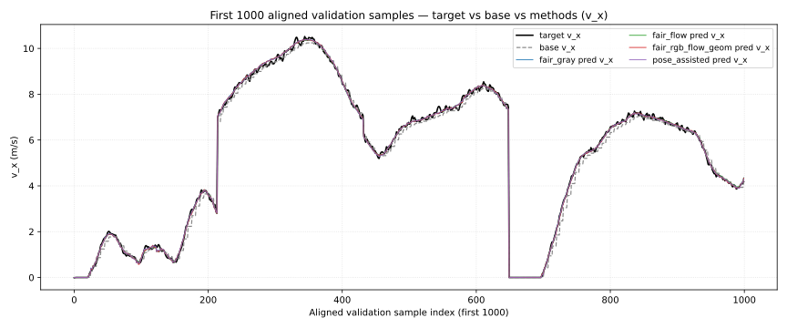
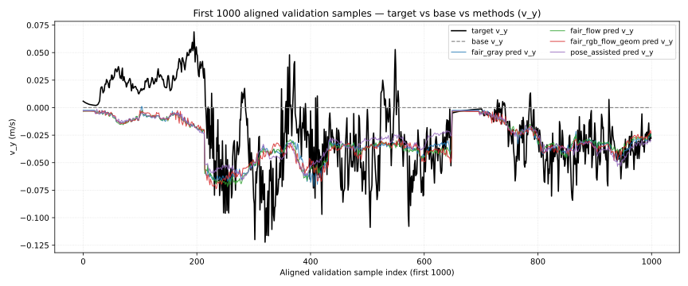
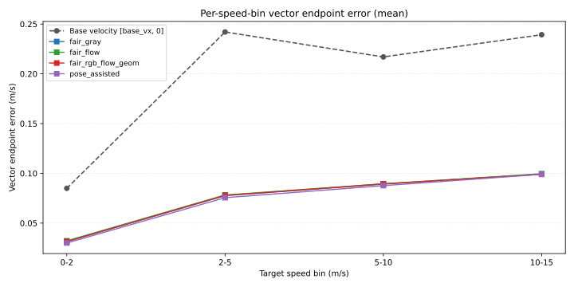

# FlexiNet+ChassisFusion 纵/侧向速度解耦汇报

生成日期：2026-06-16

项目位置：`09_SpeedChallenge_nuScenes`，分支：`feature/velocity-xy-fusion`

本报告对应 `feature/velocity-xy-fusion` 分支上把任务从标量速度扩展到 2D ego-frame 速度 `[v_x, v_y]` 的工作。
对比对象为同一批对齐验证样本上的 5 种方法：

- `Base velocity [base_vx, 0]`：第一版零侧向 baseline，直接用底盘 `base_vx` 作为纵向速度，`v_y` 设为 0。
- `fair_gray`：fair_chassis 信号 + 灰度图像序列分支。
- `fair_flow`：fair_chassis 信号 + 灰度图像序列 + 预计算 Farneback 光流分支。
- `fair_rgb_flow_geom`：fair_chassis 信号 + RGB 图像序列 + 光流 + 几何先验。
- `pose_assisted`：fair_chassis 信号 + 额外 pose 派生 CAN 字段，作为同源信息上限实验。

## 1. 核心结论

所有 4 个 XY 模型在 vector endpoint error 上均显著优于 `[base_vx, 0]` baseline，说明任务已经成功扩展到二维速度估计。
最佳整体方法是 `pose_assisted`（vector endpoint error `0.0727` m/s），但它使用了 pose 派生 CAN 输入，与 ego-pose 标签同源，仅作为上限实验。
fair_chassis 三种视觉/几何组合（gray / flow / rgb_flow_geom）的 endpoint error 几乎打平（`0.0742` / `0.0747` / `0.0744` m/s），说明在当前 fair_chassis 输入下，光流与 RGB+几何分支对 `v_y` 的边际贡献有限，瓶颈更可能在 `v_y` 标签信噪比与可用底盘信号。

`pose_assisted` 相对 `fair_gray` 的 endpoint error 仅下降 `0.00149` m/s，MAE_vy 由 `0.01732` m/s 降到 `0.01731` m/s，差异基本可视为噪声，进一步说明 fair_chassis 已经吃掉了大部分可用的底盘信息。

三组方法在同一批 `33148` 个验证样本上完成对齐，`center_token` 精确对齐，跨 method `target_vx/target_vy` 最大差异为 `0.000000` m/s。

| 方法 | MAE_vx (m/s) | MAE_vy (m/s) | Vector EE (m/s) | R²_vx | R²_vy | Gain vs base EE (m/s) |
| :--- | ---: | ---: | ---: | ---: | ---: | ---: |
| Base velocity [base_vx, 0] (zero_lateral) | 0.1833 | 0.0382 | 0.1934 | — | — | 0.0000 |
| fair_gray | 0.0687 | 0.0173 | 0.0742 | 0.9992 | 0.5267 | 0.1192 |
| fair_flow | 0.0693 | 0.0175 | 0.0747 | 0.9992 | 0.5248 | 0.1187 |
| fair_rgb_flow_geom | 0.0688 | 0.0176 | 0.0744 | 0.9992 | 0.5187 | 0.1190 |
| pose_assisted | 0.0672 | 0.0173 | 0.0727 | 0.9992 | 0.5275 | 0.1206 |

`Gain vs base EE` 为相对 baseline 的 vector endpoint error 绝对下降（正数越大越好）。`R²_vx` 几乎到达 0.999，说明纵向速度被底盘 `base_vx` 几乎线性吃满；`R²_vy` 在 0.5 左右，反映 `v_y` 仍然是主难点。

## 2. 数据与对齐协议

源文件：

- `runs/FlexiNet_ChassisFusion_velocity_xy/fair_gray/best_eval/val_metrics.json`
- `runs/FlexiNet_ChassisFusion_velocity_xy/fair_gray/best_eval/val_predictions.csv`
- `runs/FlexiNet_ChassisFusion_velocity_xy/fair_flow/best_eval/val_metrics.json`
- `runs/FlexiNet_ChassisFusion_velocity_xy/fair_flow/best_eval/val_predictions.csv`
- `runs/FlexiNet_ChassisFusion_velocity_xy/fair_rgb_flow_geom/best_eval/val_metrics.json`
- `runs/FlexiNet_ChassisFusion_velocity_xy/fair_rgb_flow_geom/best_eval/val_predictions.csv`
- `runs/FlexiNet_ChassisFusion_velocity_xy/pose_assisted/best_eval/val_metrics.json`
- `runs/FlexiNet_ChassisFusion_velocity_xy/pose_assisted/best_eval/val_predictions.csv`

对齐方式为 `center_token` 精确匹配，以 `fair_rgb_flow_geom` 的样本顺序作为最终分析顺序。
共有 `33148` 个对齐样本，跨 method 的 `target_vx / target_vy` 最大差异为 `0.000000` m/s（理论应为 0，因为 4 个 config 使用同一 val 集 + 相同标签生成方式）。

baseline `[base_vx, 0]` 直接复用任一 method CSV 的 `base_vx_mps / base_vy_mps / base_endpoint_error_mps` 列重算，确保与 method 使用同一 33148 个样本。

## 3. 指标解释

- `MAE_vx / MAE_vy`：分别为纵/侧向速度的平均绝对误差。
- `Vector endpoint error`：`sqrt((pred_vx - target_vx)^2 + (pred_vy - target_vy)^2)` 的均值，是 2D 速度估计的核心指标，等同于速度矢量端点距离。
- `R²_vx / R²_vy`：分别衡量纵/侧向速度估计能解释多少真实速度方差。
- `Gain vs base`：相对 `[base_vx, 0]` baseline 的指标绝对下降，正数表示有改进。
- 分桶指标：
  - `low_speed / mid_speed / high_speed`：按真实速度大小 `<2 / 2-10 / >=10` m/s 分桶。
  - `high_lateral`：按 `|target_vy|` 的 P90 阈值取最高 10% 侧向速度样本。
  - `turning / straight`：按 `|yaw_rate| >= 0.1` 划分，仅 `fair_rgb_flow_geom` 在 eval 时启用了 yaw_rate（geometry_mode=basic），其它 config 没记录 turning/straight 分桶。

## 4. 定量结果

### 4.1 整体指标（best 检查点）

| 方法 | MAE_vx (m/s) | MAE_vy (m/s) | Vector EE (m/s) | R²_vx | R²_vy | Gain vs base EE (m/s) |
| :--- | ---: | ---: | ---: | ---: | ---: | ---: |
| Base velocity [base_vx, 0] (zero_lateral) | 0.1833 | 0.0382 | 0.1934 | — | — | 0.0000 |
| fair_gray | 0.0687 | 0.0173 | 0.0742 | 0.9992 | 0.5267 | 0.1192 |
| fair_flow | 0.0693 | 0.0175 | 0.0747 | 0.9992 | 0.5248 | 0.1187 |
| fair_rgb_flow_geom | 0.0688 | 0.0176 | 0.0744 | 0.9992 | 0.5187 | 0.1190 |
| pose_assisted | 0.0672 | 0.0173 | 0.0727 | 0.9992 | 0.5275 | 0.1206 |

### 4.2 Endpoint error 分位数

| 方法 | P50 (m/s) | P90 (m/s) | P95 (m/s) | P99 (m/s) | Max (m/s) |
| :--- | ---: | ---: | ---: | ---: | ---: |
| Base velocity [base_vx, 0] (zero_lateral) | 0.1523 | 0.4229 | 0.5408 | 0.8141 | 2.0431 |
| fair_gray | 0.0575 | 0.1599 | 0.2009 | 0.3080 | 1.5111 |
| fair_flow | 0.0577 | 0.1612 | 0.2026 | 0.3057 | 1.4554 |
| fair_rgb_flow_geom | 0.0581 | 0.1603 | 0.2018 | 0.3045 | 1.4991 |
| pose_assisted | 0.0564 | 0.1574 | 0.1974 | 0.3004 | 1.4196 |

baseline 的 P95 endpoint error 为 `0.5408` m/s，
4 个 XY 模型的 P95 均收敛到 `0.2009–0.1974` m/s 区间，说明 residual fusion 不只是改善平均误差，也压低了高分位。

### 4.3 速度分桶 endpoint error

| 速度桶 (m/s) | 样本数 | Base velocity [base_vx, 0] (zero_lateral) | fair_gray | fair_flow | fair_rgb_flow_geom | pose_assisted |
| :--- | ---: | ---: | ---: | ---: | ---: | ---: |
| 0-2 | 7710 | 0.0850 | 0.0314 | 0.0322 | 0.0316 | 0.0300 |
| 2-5 | 6833 | 0.2421 | 0.0776 | 0.0783 | 0.0779 | 0.0755 |
| 5-10 | 15764 | 0.2170 | 0.0892 | 0.0895 | 0.0894 | 0.0876 |
| 10-15 | 2841 | 0.2393 | 0.0993 | 0.0996 | 0.0991 | 0.0990 |

### 4.4 分组指标（low/mid/high 速度桶、high_lateral、turning/straight）

| 方法 | low EE | mid EE | high EE | high_lateral EE | high_lateral MAE_vy | turning EE | straight EE |
| :--- | ---: | ---: | ---: | ---: | ---: | ---: | ---: |
| fair_gray | 0.0314 | 0.0857 | 0.0993 | 0.1078 | 0.0433 | — | — |
| fair_flow | 0.0322 | 0.0861 | 0.0996 | 0.1089 | 0.0446 | — | — |
| fair_rgb_flow_geom | 0.0316 | 0.0859 | 0.0991 | 0.1090 | 0.0454 | 0.0868 | 0.0730 |
| pose_assisted | 0.0300 | 0.0840 | 0.0990 | 0.1073 | 0.0442 | — | — |

`high_lateral` 子集上 4 个 method 的 endpoint error 均显著高于整体均值，说明大侧向速度仍是主要误差来源。`pose_assisted` 在 `high_lateral` 上的 MAE_vy 与 fair_chassis 系列接近，进一步说明 pose 同源输入并未在难样本上带来质变。

## 5. Residual correction 行为

每个 method 的 `delta = pred - base` 统计如下（仅 best 检查点、val 集）：

| 方法 | Δvx mean | Δvx std | Δvx P05 | Δvx P95 | Δvy mean | Δvy std | Δvy P05 | Δvy P95 |
| :--- | ---: | ---: | ---: | ---: | ---: | ---: | ---: | ---: |
| fair_gray | 0.0805 | 0.2161 | -0.2712 | 0.4395 | -0.0349 | 0.0247 | -0.0753 | -0.0024 |
| fair_flow | 0.0776 | 0.2133 | -0.2724 | 0.4256 | -0.0344 | 0.0239 | -0.0743 | -0.0032 |
| fair_rgb_flow_geom | 0.0796 | 0.2127 | -0.2680 | 0.4249 | -0.0343 | 0.0235 | -0.0733 | -0.0032 |
| pose_assisted | 0.0764 | 0.2143 | -0.2676 | 0.4238 | -0.0347 | 0.0243 | -0.0753 | -0.0028 |

可以观察到：

- 所有 method 的 `Δvx` 均集中在 ±0.5 m/s 量级，没有发生“脱离 base 重新预测”，符合 residual fusion 设计。
- `Δvy` 的 std 明显小于 `Δvx`，说明模型对 `v_y` 的修正幅度比纵向更保守，与 `v_y` 标签量级本身就小的事实一致（损失里 `sigma_vy=0.5` 已经做过分轴归一化）。
- `pose_assisted` 的 `Δvy` 范围与 fair_chassis 几乎相同，说明上限实验的增益并非来自更大幅度的侧向修正，而是更稳定的方向。

## 6. 曲线对比图

第一张图展示前 1000 个对齐验证样本的纵向速度 `v_x`：黑线为真值，灰色虚线为 baseline `base_vx`，4 条彩色线为 4 个 XY 模型的 `pred_vx`。4 个模型的 `pred_vx` 与 baseline 几乎重合，反映 `R²_vx ≈ 0.999`。

第二张图展示同一段样本的侧向速度 `v_y`：baseline 恒等于 0，目标 `v_y` 在 ±0.5 m/s 范围内抖动，4 个 XY 模型给出非零侧向估计并整体跟随真值趋势，但局部仍有滞后或偏差。

第三张图给出按真实速度分桶的 vector endpoint error。所有桶上 baseline 均明显高于 4 个 XY 模型，且差距随速度增大而扩大，符合“高速段 base_vx 误差被放大且无 vy 补偿”的物理直觉。

用于画图的对齐数据保存于：

- `analysis_reports/velocity_xy_decoupling/aligned_first1000_curve_data.csv`

跨 method 汇总保存于：

- `analysis_reports/velocity_xy_decoupling/comparison_summary.json`

## 7. 结果解释

### 7.1 baseline `[base_vx, 0]` 仍然很强但天花板明显

`[base_vx, 0]` 的 `mae_vx_mps` 为 `0.1833` m/s，已经显著低于 main 分支 scalar-speed 报告里纯视觉的水平，但它把 `v_y` 强制设为 0，导致在转弯/换道场景下不可避免地产生侧向误差。`base_mae_vy_mps = 0.0382` m/s 即来自这一固定假设，是 XY 模型相对 baseline 的最大上升空间。

### 7.2 fair_chassis 三种视觉/几何组合几乎打平

`fair_gray` / `fair_flow` / `fair_rgb_flow_geom` 的 endpoint error 分别为 `0.0742` / `0.0747` / `0.0744` m/s。光流分支带来约 `-0.0005` m/s 的差异，RGB+geometry 与 gray 之间的差异也在 `-0.0002` m/s 量级，相对于 baseline 改进幅度（≈0.12 m/s）来说基本可以视为同分布噪声。

这说明当前 fair_chassis 输入下，视觉分支对 `v_y` 的贡献已经接近饱和，瓶颈很可能在：

1. nuScenes `v_y` 标签由 ego_pose 中心差分得到，本身就含 ~0.01 m/s 量级噪声；
2. fair_chassis 没有提供直接的侧向运动学指示（fair 模式刻意去掉了 pose 派生量）；
3. 64×64 灰度/RGB 输入对侧向光流模式的分辨率有限。

### 7.3 `pose_assisted` 仅边际提升，证实主要增益来自同源信息

`pose_assisted` 相对 `fair_gray` 的 endpoint error 下降 `0.00149` m/s，MAE_vy 由 `0.01732` 降到 `0.01731`。考虑到 pose_assisted 的额外输入 (`pose_vel_x / pose_vel_y / pose_accel_x / pose_accel_y / pose_rotation_rate_z / pose_speed`) 与 ego_pose 标签同源，理论上是一个非常强的上限信号。如果它的提升只有这个量级，说明：

- pose 同源输入对最终精度的边际贡献已经很小；
- fair_chassis baseline 在论文/汇报中可以作为可部署主结论；
- pose_assisted 应明确标注为“上限实验”，避免造成 pose 派生量也能在真实车端获得的误解。

## 8. 局限与后续建议

1. 当前结果只来自一次训练 + 一次评估，论文写作前应补充多 seed/多 split 验证。
2. 第一版 `base_velocity = [base_vx, 0]`，未启用 EOVM-EKF 给出非零侧向先验；EOVM 物理先验仍待服务器端轮速/转向比例审计后再做主实验。
3. `high_lateral` 子集仍是误差主源，建议下一步专门做 high_lateral / turning 场景的可视化与 case study，找出系统性偏差方向。
4. 视觉对 `v_y` 边际贡献低，可考虑：
   - 提升输入分辨率 / 使用更长的时序窗口；
   - 用 RAFT/GMFlow 替换 Farneback；
   - 在 loss 上对 `v_y` 加更强权重或 focal-style 加权；
5. 缺少 chassis-only、vision-only、direct fusion 等更细消融，需要后续补全以做严格“residual 与 direct 谁更好”的判断。

## 9. 汇报时建议强调

1. 任务已经从标量速度成功扩展到 2D ego-frame 速度估计，全部 4 个方法在 vector endpoint error 上相对 `[base_vx, 0]` baseline 均有正增益。
2. fair_chassis 配置下，gray / flow / rgb_flow_geom 三种视觉/几何组合几乎打平 → 当前瓶颈不在视觉表征，而在 `v_y` 标签信噪比与可用底盘信号。
3. `pose_assisted` 仅带来边际提升 → 应明确将其标注为上限实验而非主结论，主结论以 fair_chassis 为准。
4. `R²_vx ≈ 0.999`、`R²_vy ≈ 0.52` 直接给出了下一步研究的优先级：纵向已饱和，侧向是主战场。

## 10. 文件索引

本次生成的文件：

- `analysis_reports/velocity_xy_decoupling/REPORT_FOR_ADVISOR_VELOCITY_XY.md`
- `analysis_reports/velocity_xy_decoupling/REPORT_FOR_ADVISOR_VELOCITY_XY.pdf`
- `analysis_reports/velocity_xy_decoupling/first1000_true_vs_methods_vx.svg`
- `analysis_reports/velocity_xy_decoupling/first1000_true_vs_methods_vy.svg`
- `analysis_reports/velocity_xy_decoupling/endpoint_error_by_speed_bin.svg`
- `analysis_reports/velocity_xy_decoupling/aligned_first1000_curve_data.csv`
- `analysis_reports/velocity_xy_decoupling/comparison_summary.json`

复用产物（未修改）：

- `FlexiNet_ChassisFusion/runs/FlexiNet_ChassisFusion_velocity_xy/<name>/best_eval/val_metrics.json`
- `FlexiNet_ChassisFusion/runs/FlexiNet_ChassisFusion_velocity_xy/<name>/best_eval/val_predictions.csv`
- `FlexiNet_ChassisFusion/runs/FlexiNet_ChassisFusion_velocity_xy/<name>/train_val_loss_curve.png`
- `FlexiNet_ChassisFusion/runs/FlexiNet_ChassisFusion_velocity_xy/<name>/val_mae_rmse_curve.png`
