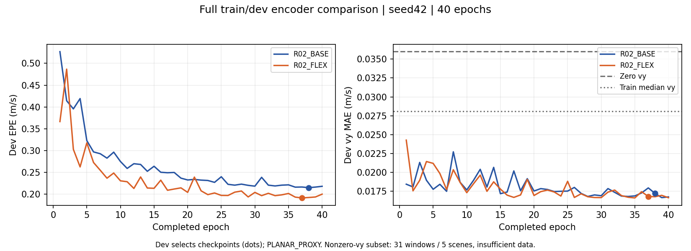

# R02_BASE / R02_FLEX：完整40轮对照完成

**建议：保留BASE作为直接参照，FLEX作为优先候选，下一步两组均补seed43/44再决定是否正式采用。** 本次FLEX的dev EPE降低10.93%，76/103场景改善，整体vy误差略降；但非零侧向MAE略升、样本不足，单seed不能称为显著优势，也不能宣称侧向能力已得到验证。本轮不启动后续RGB Frozen/FT或其他seed。

两组都完成582个train_core场景/132978窗口、103个dev场景/23480窗口、seed42、40个完整epoch。冻结RAFT；同一1024×576生成/128×72训练视图；仅四对历史有符号光流及四个真实dt；均训练完整编码器和速度头。dev用于选模和这里的独立重算，不是封存测试集。标签仍是nuScenes后轴中点的PLANAR_PROXY，原分区不是log隔离。

训练commit **`a847938681d60ae86e0e293e24ffa7d2e74e20a9`**；固定detached目录和全部命令见[启动记录](ENCODER_RUN_20261031.md)。最终比较最初由结果分支commit **`4642ab8e3dfcf2e30099bce51b76e4bd97a28d2d`**发布，并以实际远端SHA核实；之后报告提交不改变训练版本。两组均只启动一次，无重跑。

## 评价

所有误差单位为m/s，bias为预测减标签。每组独立evaluate进程重载best，在完整dev重算；比较器核对预测标签覆盖、逐轮数据顺序、最优epoch、checkpoint及逐样本CSV哈希。服务器CSV与GitHub导出字节再次核对一致。

| 指标 | R02_BASE | R02_FLEX |
|---|---:|---:|
| EPE | 0.215142 | 0.191630 |
| vx MAE | 0.212016 | 0.188479 |
| vx RMSE | 0.414209 | 0.371284 |
| vx bias | -0.018107 | -0.019759 |
| vy MAE | 0.017229 | 0.016827 |
| vy RMSE | 0.026374 | 0.026239 |
| vy bias | -0.003579 | -0.002414 |
| 最佳epoch（1起） | 38 | 37 |

FLEX EPE绝对降低0.023512 m/s，相对降低10.9285%；逐场景76个改善、27个退化。[103场景可读CSV](evidence/encoder_scene_comparison_20261031.csv)；所有分量、RMSE、bias等完整逐场景结果在结果分支summary.json中。

图中圆点是EPE选中的checkpoint，不按vy曲线再选一次。无曲线平滑。

## 侧向及常量基线

`abs(target_vy)>=0.2m/s`仅31窗口/5场景，未达100窗口/5场景，严格保留`insufficient_data`。整体vy接受检查pass，联合侧向接受状态不是pass。

| 侧向指标 | 零vy | train中位数vy | BASE | FLEX |
|---|---:|---:|---:|---:|
| 全dev vy MAE | 0.035984 | 0.028078 | 0.017229 | 0.016827 |
| 全dev vy RMSE | 0.049530 | 0.036821 | 0.026374 | 0.026239 |
| 全dev vy bias | 0.033824 | 0.006828 | -0.003579 | -0.002414 |
| 非零子集 vy MAE | 0.266517 | 0.255196 | 0.226315 | 0.228601 |
| 非零子集 vy RMSE | 0.279856 | 0.276387 | 0.261180 | 0.261172 |
| 非零子集 vy bias | 0.049236 | 0.022240 | -0.012898 | -0.007596 |

FLEX非零子集vy MAE比BASE高0.002286 m/s；不能用总体EPE收益掩盖这个方向的退化，更不能把不足样本的接受检查改成通过。FLEX子集二维EPE为0.320275，BASE为0.418177，主要伴随vx改善。

中位数仅从train_core的132978个窗口拟合：`vy=-0.0269965362`。同时报告二维train中位数常量`[5.3115406036,-0.0269965362]`，其dev EPE为3.009622。旧侧向常量证据经相同标签清单重算核对复用，没有用dev拟合常量。

## 成本及更新计数

| 项目 | BASE | FLEX |
|---|---:|---:|
| 可训练参数 | 74354 | 76850 |
| 正式训练墙钟（含每轮dev及保存） | 1215.54s | 1241.89s |
| worker完整墙钟（含准备及独立评价） | 1265.45s | 1285.43s |
| 训练窗口吞吐（含每轮dev及保存成本） | 4375.94/s | 4283.10/s |
| torch峰值allocated显存 | 176.68MB | 177.64MB |
| processed batches | 83120 | 83120 |
| optimizer updates | 83089 | 83087 |
| AMP skips | 31 | 33 |

两组相同40轮和样本顺序政策，所有40个epoch顺序SHA一致；共同头初始化SHA一致。AMP跳步率约0.0373%/0.0397%，所以实际更新数相差2，不能写成更新数完全一致。动态loss scale正常处理溢出，本轮没有因此改算法或重启。

参数差3.36%，本机正式训练墙钟差2.17%；这**不等于等计算成本**。同一GPU1、训练前真实驻留batch64短测为BASE约21298窗口/s、FLEX约10531窗口/s，FLEX约慢2倍，短测不含数据读取/验证/保存及梯度裁剪，详见[设计和验证范围](ENCODER_COMPARISON_20261031.md)。

正式作业在两张5090并行，分享CPU和数据通路；GPU1从13:54:32起还有与本轮无关的ToDesk会话（未停止它）。因此上表墙钟是此服务器环境下的实际成本，不能将差异完全归因编码器。峰值allocated只计PyTorch本进程，不含CUDA上下文或桌面显存。

## 发布、权重及巡视收尾

artifact根：`/home/zhangyu/.local/share/speedest-v5-next`。run IDs为`20261031_r02_base_flex_s42_R02_BASE`和`20261031_r02_base_flex_s42_R02_FLEX`。

- 日志：`logs/<run_id>.log`。
- 完整恢复状态：`runs/<run_id>/last.pt`；选中checkpoint：`runs/<run_id>/best.pt`。
- 独立评价：`evaluations/<run_id>/{evaluation.json,metrics.json,predictions.csv}`。
- 最终比较：`reports/encoder_comparison_20261031_r02_base_flex_s42/summary.{json,md}`；原summary SHA256 `5aa3ffb431408b24e67a42e6655b793ee6550a74e3423812156d8d788474370d`。
- BASE best SHA256 `deaf835444344756b03b10e6f6c32e4bffb5358896866251fbcfee18d27193a4`。
- FLEX best SHA256 `4d24688a71935d135a9b153ce568f31b4f2fd9845197c89bdf5accbec43ec823`。

公开位置：[结果与全部工件导航](https://github.com/reingorcement/SpeedChallenge_nuScenes/tree/results/purevision-v5-next/methods/purevision-flow/PureVision_V5/docs/next_results)、[完整比较JSON](https://github.com/reingorcement/SpeedChallenge_nuScenes/blob/results/purevision-v5-next/methods/purevision-flow/PureVision_V5/docs/next_results/comparisons/encoder_comparison_20261031_r02_base_flex_s42/summary.json)、[逐样本预测及各run收据](https://github.com/reingorcement/SpeedChallenge_nuScenes/tree/results/purevision-v5-next/methods/purevision-flow/PureVision_V5/docs/next_results/experiments)。两个逐样本CSV均为全23480行，约3.37MB，没有只上传抽样。完整权重及缓存留服务器。

本轮13:53 cron探针与14:00正式半小时Astra均实际成功读取本轮工件；5分钟server检查实际运行，小时发布完成cron触发测试并恢复小时周期，里程碑另及时发布。期间SSH间歇超时，保留pending并重试，未影响正常训练。最终评价/比较已完成并核实远端发布后，生命周期程序移除本轮专属cron并退出；独立核查crontab空、tmux无残留、本轮训练PID均不存在、运行worktree仍干净。ToDesk不是训练残留，保持原状。[最终独立核查及巡视回执](evidence/encoder_terminal_inspection_20261031.json)。

Astra指出巡视中的validation偶有滞后。已定位为worker轮询可能错过短暂的epoch末状态，巡视器又优先读worker缓存；开发分支收尾修正为优先读取metrics.jsonl最后一条完整验证，并标明对应epoch。针对性监控/发布检查30项通过，修复commit为`3ef7d70da726bfedb5f36f082e64a5499a99afbb`。这只修正后续巡视展示，不改变本轮固定运行目录、训练记录、checkpoint选模或独立评价，无需重跑。

## 选择依据与下一步

FLEX优先值得补seed：EPE与vx误差改善较明确、76/103场景方向一致、整体vy略降，参数增加较小。但短时计算吞吐约减半，非零侧向MAE略升且数据不足，单seed和dev选模也限制结论。保留BASE直接基线，建议下一批BASE/FLEX各补seed43、44，仍完整数据及40轮、相同头初始化政策和各seed成对顺序。不要仅延长FLEX预算或用旧pilot替代BASE。

若多seed仍保持收益，再结合成本及更充分侧向证据讨论采用FLEX。当前结果支持“该候选在本次PLANAR_PROXY dev上有价值”，不支持统计显著、真实体轴目标成功、个别SFE/MFE模块独立有效或RGB融合收益等更强结论。

补seed不会增加独立侧向窗口数，不能将相同31个窗口重复计数来达到门槛。补充侧向评价数据涉及本轮之外的方案，应另交用户确认；当前不改划分或阈值。
