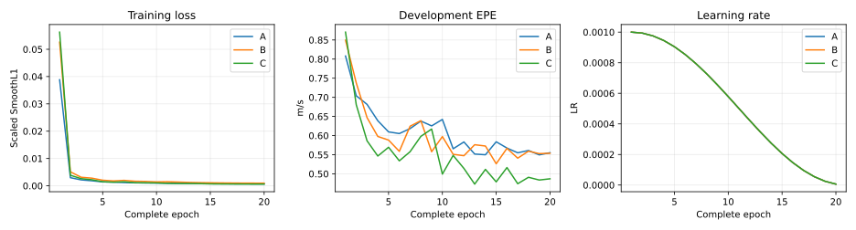

# Frozen-encoder A/B/C fusion pilot

Status: **completed**. Experiment: `20261101_2129_fusion_abc_s42`.
Actual training commit: `8eac695a778ee7bedc40ffe23fc42214c854811b`.

C has the lowest dev EPE in this completed single-seed frozen-feature pilot. Treat it as a candidate for a user-approved next comparison, not established superiority.

| Model | Best epoch | Best dev EPE | Last dev EPE | Best train EPE | vx MAE | vy MAE | Parameters | Updates | Seconds |
|---|---:|---:|---:|---:|---:|---:|---:|---:|---:|
| A | 19 | 0.549545 | 0.555171 | 0.176586 | 0.546547 | 0.024094 | 124354 | 2300 | 7.8 |
| B | 15 | 0.526315 | 0.553743 | 0.214203 | 0.523877 | 0.023367 | 100738 | 2300 | 9.2 |
| C | 13 | 0.473079 | 0.486954 | 0.207096 | 0.469896 | 0.022717 | 101250 | 2300 | 15.3 |

| Comparison | Dev EPE delta (m/s) | Relative delta | Improved / degraded / tied scenes | Nonzero-vy |
|---|---:|---:|---:|---|
| B_minus_A | -0.023231 | -4.23% | 2 / 6 / 0 | insufficient_data |
| C_minus_B | -0.053236 | -10.11% | 7 / 1 / 0 | insufficient_data |
| C_minus_A | -0.076467 | -13.91% | 4 / 4 / 0 | insufficient_data |

All three groups completed20 epochs/2300 batches/2300 optimizer updates with AMP disabled. Full component metrics, GPU identities, cache/source hashes and paired comparisons are in summary.json.

Review paired scene and lateral outcomes first. Any extra seeds, full-data training, or encoder changes require a separate user decision; none are launched by this report.

- Single seed42, 32 training scenes and 8 development scenes: exploratory development screening only.
- Encoders were already trained on the complete original training partition; the source checkpoint was selected on the existing complete dev. Only the new readouts use 32 training scenes.
- A/B change both fusion and readout. B/C are not a strict attention-only ablation (their feedforward widths and block structures also differ).
- PRO6000 and RTX5090 wall times are not a same-hardware efficiency comparison.
- Nonzero-vy inference requires at least 100 independent windows and 5 scenes; otherwise insufficient_data. Repeated training does not add independent samples.
- PLANAR_PROXY rear-axle labels, dev-selected checkpoints, and a split that is not log-disjoint; no held-out or full-data stable advantage claim.
- The experiment assesses these frozen features and new readouts, not the accuracy limit of visual velocity estimation.
