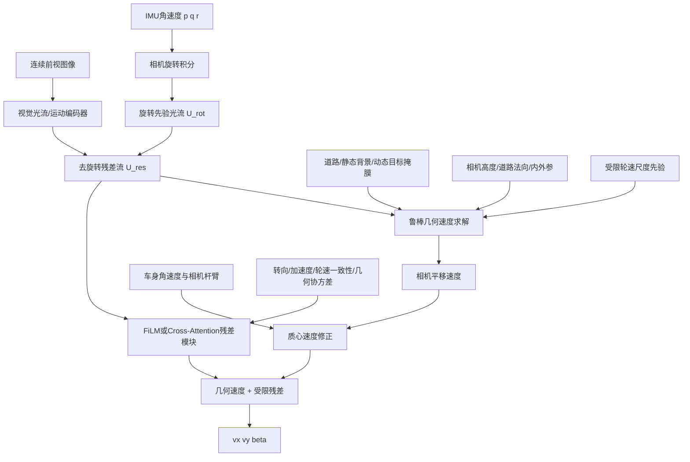

# 视觉—运动学—动力学辅助车辆纵侧向速度估计技术研究思路（修订版）

## 1. 研究目标

面向单目前视连续视频，结合车辆IMU、转向、轮速及其他底盘信号，研究一种**视觉主导、运动学与动力学信息辅助、弱模型约束**的车辆纵侧向速度估计方法，输出车辆质心坐标系下：

\[
\hat{\mathbf v}_{\mathrm{CG},t}^{b}
=
\begin{bmatrix}
\hat v_{x,t} &
\hat v_{y,t}
\end{bmatrix}^{\mathrm T},
\]

并可进一步计算质心侧偏角：

\[
\hat\beta_t
=
\operatorname{atan2}
\left(
\hat v_{y,t},
\hat v_{x,t}
\right).
\]

本研究不以完整车辆动力学模型和轮胎模型为核心，不要求预先准确获得：

\[
m,\quad
I_z,\quad
C_f,\quad
C_r,\quad
\mu,\quad
F_{yf},\quad
F_{yr}.
\]

核心信息流为：

\[
\boxed{
\text{车辆运动学/动力学信号}
\rightarrow
\text{辅助解释视觉运动}
\rightarrow
\text{视觉主导的公制 }v_x,v_y\text{ 估计}
}
\]

而不是：

\[
\text{视觉估计器}
+
\text{动力学估计器}
\rightarrow
\text{结果级加权融合}.
\]

---

# 2. 研究定位

## 2.1 推荐名称

中文：

> **车辆运动状态条件化的视觉纵侧向速度估计**

英文：

> **Vehicle-Motion-Conditioned Visual Longitudinal and Lateral Velocity Estimation**

若强调弱模型：

> **Weakly Model-Guided Visual–Chassis Fusion for Vehicle Velocity Estimation**

## 2.2 “无模型”与“弱模型”的边界

### 近无模型部分

以下模块可完全由数据驱动完成：

- 视觉时空特征提取；
- 光流或运动特征提取；
- 底盘运动状态编码；
- FiLM视觉特征调制；
- Cross-Attention视觉证据选择；
- 几何解残差修正。

### 弱模型部分

为了恢复物理正确的公制速度，应保留以下可靠几何与运动学关系：

1. 相机内外参；
2. 相机—IMU外参；
3. IMU角速度到旋转光流的刚体几何关系；
4. 相机速度到车辆质心速度的杆臂关系；
5. 道路平面或公制深度；
6. 车辆坐标系速度—加速度一致性关系。

因此最终方法应定位为：

> **弱几何、弱运动学模型引导的视觉纵侧向速度估计方法。**

---

# 3. 三个必须优先解决的基础问题

## 3.1 单目公制尺度不可观测

单目平移光流满足：

\[
\mathbf u_i
=
\frac{1}{Z_i}
\mathbf J_i
\mathbf T
\Delta t.
\]

如果：

\[
Z_i'=\lambda Z_i,
\qquad
\mathbf T'=\lambda\mathbf T,
\]

则光流保持不变。因此，FiLM和Cross-Attention只能改善视觉信息使用方式，不能从结构上解决尺度不可观测。

本研究至少需要一个尺度来源：

1. 已知相机高度与道路平面；
2. 公制深度网络；
3. 轮速提供受限尺度先验；
4. GNSS/INS速度真值监督；
5. 固定相机和固定车辆条件下的统计尺度学习。

其中第5种只能称为固定域监督回归，不能宣称从单目视觉中解析恢复绝对尺度。

### 推荐选择

第一版采用：

\[
\boxed{
\text{已知相机高度}
+
\text{道路平面}
+
\text{受限轮速尺度先验}
}
\]

后续再比较公制深度网络。

---

## 3.2 相机速度不等于车辆质心速度

前视相机通常不位于车辆质心。车辆存在角速度时：

\[
\mathbf v_c^b
=
\mathbf v_{\mathrm{CG}}^b
+
\boldsymbol\omega_b
\times
\mathbf r_c^b.
\]

因此：

\[
\boxed{
\mathbf v_{\mathrm{CG}}^b
=
\mathbf v_c^b
-
\boldsymbol\omega_b
\times
\mathbf r_c^b
}
\]

其中：

- \(\mathbf v_c^b\)：相机安装点的线速度；
- \(\mathbf v_{\mathrm{CG}}^b\)：车辆质心速度；
- \(\boldsymbol\omega_b\)：车身角速度；
- \(\mathbf r_c^b\)：相机相对车辆质心的位置。

训练标签也必须统一到质心位置。若GNSS/INS真值来自天线安装点，同样需要：

\[
\mathbf v_{\mathrm{CG}}^b
=
\mathbf v_{\mathrm{antenna}}^b
-
\boldsymbol\omega_b
\times
\mathbf r_{\mathrm{antenna}}^b.
\]

---

## 3.3 IMU原始输出不能直接进入运动学一致性损失

IMU输出通常是安装点处比力，不是质心处去重力后的惯性加速度。

需要计算：

\[
\mathbf a_{\mathrm{CG}}
=
\mathbf R_{bi}\mathbf f_{\mathrm{imu}}
+
\mathbf g_b
-
\dot{\boldsymbol\omega}
\times
\mathbf r_i
-
\boldsymbol\omega
\times
\left(
\boldsymbol\omega
\times
\mathbf r_i
\right).
\]

其中：

- \(\mathbf R_{bi}\)：IMU坐标系到车身坐标系旋转；
- \(\mathbf f_{\mathrm{imu}}\)：IMU比力；
- \(\mathbf r_i\)：IMU相对质心杆臂；
- \(\dot{\boldsymbol\omega}\)：角加速度。

角加速度不应直接用高噪声差分，建议采用：

- 低通滤波后差分；
- Savitzky–Golay微分；
- EKF/平滑器估计；
- 学习式置信度权重。

只有完成补偿后，才使用：

\[
a_x
\approx
\dot v_x-rv_y,
\]

\[
a_y
\approx
\dot v_y+rv_x.
\]

---

# 4. 总体技术路线

建议采用“快速基线 + 物理主线 + 学习式残差”的双线并行结构。

## 4.1 快速数据基线

目的：

- 验证数据集和标签是否正确；
- 验证单目前视视频中是否存在足够的 \(v_x,v_y\) 信息；
- 识别最困难工况；
- 为物理主线提供性能下限和调试参考。

结构：

\[
I_{t-N+1:t}
\rightarrow
\text{视觉时空编码器}
\rightarrow
\hat v_x,\hat v_y.
\]

再设置普通拼接基线：

\[
[
\mathbf f_{\mathrm{vis}};
\mathbf f_{\mathrm{chassis}}
]
\rightarrow
\hat v_x,\hat v_y.
\]

该拼接模型仅作为对照，不作为最终方案。

## 4.2 物理主线

物理主线为：

\[
\boxed{
\text{IMU旋转补偿}
\rightarrow
\text{静态道路平移流提取}
\rightarrow
\text{弱几何公制速度求解}
\rightarrow
\text{质心杆臂修正}
\rightarrow
\text{学习式残差修正}
}
\]

总体结构：



---

# 5. 第一核心模块：车辆IMU引导的旋转—平移视觉运动分解

## 5.1 角速度坐标转换

车辆IMU角速度为：

\[
\boldsymbol\omega_b
=
[
p,q,r
]^{\mathrm T}.
\]

转换到相机坐标系：

\[
\boldsymbol\omega_c
=
\mathbf R_{cb}
\boldsymbol\omega_b.
\]

## 5.2 两帧间旋转积分

在相邻图像时间区间 \([t_a,t_b]\) 内：

\[
\Delta\mathbf R_{ab}
=
\prod_k
\operatorname{Exp}
\left(
[
\boldsymbol\omega_c(t_k)
]_\times
\Delta t_k
\right).
\]

对于全局快门相机：

\[
\mathbf H_\omega
=
\mathbf K
\Delta\mathbf R_{ab}
\mathbf K^{-1}.
\]

旋转光流：

\[
\mathbf U_{\mathrm{rot}}(\mathbf p)
=
\pi
\left(
\mathbf H_\omega
\tilde{\mathbf p}
\right)
-
\mathbf p.
\]

如果相机为滚动快门，应按照扫描行时间构造分段旋转，并使用四元数插值形成逐行旋转场。

## 5.3 车辆版GyroFlow的关键修正

车辆前视背景光流为：

\[
\mathbf U_{\mathrm{obs}}
=
\mathbf U_{\mathrm{rot}}
+
\mathbf U_{\mathrm{trans}}
+
\mathbf U_{\mathrm{dynamic}}
+
\boldsymbol\epsilon.
\]

因此：

\[
\boxed{
\mathbf U_{\mathrm{rot}}
\neq
\mathbf U_{\mathrm{background}}
}
\]

不能直接照搬GyroFlow中“Gyro Field与视觉流加权替换”的逻辑。

车辆版应使用：

\[
\boxed{
\text{旋转流解析给定}
+
\text{视觉估计平移残差}
}
\]

即：

\[
\mathbf U_{\mathrm{background}}
=
\mathbf U_{\mathrm{rot}}
\oplus
\mathbf U_{\mathrm{trans}}.
\]

其中 \(\oplus\) 表示光流复合。小角度、小位移时可近似相减：

\[
\mathbf U_{\mathrm{trans}}
\approx
\mathbf U_{\mathrm{visual}}
-
\mathbf U_{\mathrm{rot}}.
\]

大位移和快速转向时应使用Warp或流场复合。

## 5.4 推荐实现

```python
U_visual = flow_network(I_prev, I_curr)

U_rot = gyro_to_rotation_flow(
    gyro=gyro,
    K=K,
    R_cb=R_cb,
    frame_times=frame_times,
    time_offset=time_offset,
    gyro_bias=gyro_bias
)

U_res = compose_flow(
    U_visual,
    inverse_flow(U_rot)
)
```

其中：

\[
\mathbf U_{\mathrm{res}}
\approx
\mathbf U_{\mathrm{trans}}
+
\mathbf U_{\mathrm{dynamic}}
+
\mathbf U_{\mathrm{error}}.
\]

---

# 6. 相机—IMU时间同步与标定

## 6.1 不能直接最小化去旋转后的残差

静态背景仍包含真实平移流，因此不能用：

\[
\min_\tau
\|
\mathbf U_{\mathrm{visual}}
-
\mathbf U_{\mathrm{rot}}(\tau)
\|
\]

搜索时间偏移。否则错误的旋转流可能抵消部分真实平移流。

## 6.2 正确的时间偏移搜索

对每个候选时间偏移 \(\tau\)：

1. 构造旋转流；
2. 去除旋转；
3. 联合求解平移；
4. 计算平移拟合后的剩余误差。

\[
\tau^\star
=
\arg\min_\tau
\min_{\mathbf T}
\sum_{i\in\Omega}
\rho
\left[
\mathbf U_{\mathrm{visual},i}
-
\mathbf U_{\mathrm{rot},i}(\tau)
-
\mathbf A_i(Z_i)\mathbf T
\right].
\]

伪代码：

```python
for offset in candidate_offsets:
    U_rot = gyro_to_rotation_flow(
        gyro,
        time_offset=offset
    )

    U_res = compose_flow(
        U_visual,
        inverse_flow(U_rot)
    )

    T = robust_translation_solver(
        flow=U_res,
        depth=road_depth,
        mask=static_road_mask
    )

    score[offset] = post_fit_error(
        flow=U_res,
        translation=T,
        depth=road_depth,
        mask=static_road_mask
    )

best_offset = argmin(score)
```

后续可以将：

\[
\tau,\quad
\mathbf b_g
\]

设置为少量可学习参数，但必须加范围约束和稳定正则。

---

# 7. 第二核心模块：静态道路平移运动提取

## 7.1 有效区域

推荐使用：

\[
\mathbf M
=
\mathbf M_{\mathrm{road}}
\cdot
(1-\mathbf M_{\mathrm{dynamic}})
\cdot
\mathbf C_{\mathrm{flow}}
\cdot
\mathbf C_{\mathrm{plane}}.
\]

其中：

- \(\mathbf M_{\mathrm{road}}\)：道路区域；
- \(\mathbf M_{\mathrm{dynamic}}\)：动态目标区域；
- \(\mathbf C_{\mathrm{flow}}\)：前后向一致性或网络置信度；
- \(\mathbf C_{\mathrm{plane}}\)：道路平面一致性。

## 7.2 道路掩膜策略

第一版不应完全依赖复杂语义分割，应采用：

\[
\text{固定几何ROI}
+
\text{道路分割修正}
+
\text{低置信度回退}.
\]

```python
M_geo = calibrated_ground_roi(
    K,
    camera_height,
    nominal_pitch
)

M_road, road_conf = road_segmenter(image)

M_dynamic = dynamic_object_mask(image)

if road_conf < threshold:
    M = M_geo * (1.0 - M_dynamic)
else:
    M = (
        M_geo
        * M_road
        * (1.0 - M_dynamic)
    )
```

## 7.3 道路法向在线更新

固定相机俯仰和固定道路平面会在以下工况失效：

- 加速点头；
- 制动俯仰；
- 坡道；
- 路面起伏；
- 车辆侧倾。

建议融合：

- IMU姿态；
- 视觉地平线；
- 车道线；
- 道路平面拟合；

在线估计道路法向：

\[
\hat{\mathbf n}_{\mathrm{road},t}.
\]

---

# 8. 第三核心模块：弱几何公制速度求解

## 8.1 道路平面深度

利用相机高度 \(h_c\)、道路法向 \(\mathbf n\) 和相机内参，将道路像素恢复为公制深度：

\[
Z_i
=
g_{\mathrm{ground}}
\left(
u_i,v_i,
\mathbf K,
h_c,
\mathbf n_{\mathrm{road}}
\right).
\]

## 8.2 平移光流模型

对道路像素 \(i\)：

\[
\mathbf u_i
=
\mathbf A_i(Z_i)
\mathbf T_c.
\]

求解：

\[
\hat{\mathbf T}_c
=
\arg\min_{\mathbf T_c}
\sum_i
w_i
\rho
\left(
\mathbf u_i
-
\mathbf A_i(Z_i)\mathbf T_c
\right).
\]

## 8.3 鲁棒IRLS

```python
T = weighted_least_squares(
    A,
    b,
    weights
)

for _ in range(3):
    residual = b - A @ T

    robust_w = huber_weights(
        residual
    )

    T = weighted_least_squares(
        A,
        b,
        weights * robust_w
    )
```

## 8.4 病态检测

计算：

\[
\mathbf H
=
\mathbf A^{\mathrm T}
\mathbf W
\mathbf A.
\]

若：

\[
\kappa(\mathbf H)
>
\kappa_{\max},
\]

则当前几何求解不可置信。

应输出：

- 速度估计；
- 协方差；
- 条件数；
- 有效像素数量；
- 几何残差。

```python
if condition_number(H) > threshold:
    geometry_valid = False
else:
    geometry_valid = True
```

## 8.5 受限轮速尺度先验

轮速绝对值不能通过无约束MLP直接预测最终速度，但可以提供受限尺度先验。

例如：

\[
v_{\mathrm{wheel}}
=
R_{\mathrm{eff}}
\cdot
\operatorname{robustmean}
(\omega_i).
\]

构造几何正则：

\[
\mathcal L_{\mathrm{scale}}
=
c_{\mathrm{wheel}}
\left|
\|\hat{\mathbf v}_{\mathrm{geo}}\|
-
v_{\mathrm{wheel}}
\right|.
\]

其中 \(c_{\mathrm{wheel}}\) 由以下因素决定：

- 四轮轮速一致性；
- 加速度；
- 驱动/制动状态；
- 滑移风险；
- ABS/TCS状态。

也可以只允许轮速修正一个小范围尺度：

\[
s_t
=
1+
\Delta s_t,
\qquad
\Delta s_t\in[-\epsilon_s,\epsilon_s].
\]

\[
\hat{\mathbf v}_{\mathrm{geo}}'
=
s_t
\hat{\mathbf v}_{\mathrm{geo}}.
\]

---

# 9. 第四核心模块：相机速度到质心速度

相机坐标系平移速度：

\[
\mathbf v_c^c
=
\frac{\mathbf T_c}{\Delta t}.
\]

转换到车身坐标系：

\[
\mathbf v_c^b
=
\mathbf R_{bc}
\mathbf v_c^c.
\]

进行杆臂修正：

\[
\boxed{
\mathbf v_{\mathrm{CG}}^b
=
\mathbf v_c^b
-
\boldsymbol\omega_b
\times
\mathbf r_c^b
}
\]

最终取：

\[
\hat v_x
=
[\mathbf v_{\mathrm{CG}}^b]_x,
\qquad
\hat v_y
=
[\mathbf v_{\mathrm{CG}}^b]_y.
\]

---

# 10. 第五核心模块：学习式残差修正

几何速度能够提供物理正确的主体估计，但会受到：

- 道路非平面；
- 深度误差；
- 光流误差；
- 分割误差；
- 标定漂移；
- 车身振动；
- 动态目标残留；

影响。

因此采用：

\[
\boxed{
\hat{\mathbf v}
=
\mathbf v_{\mathrm{geo}}
+
g_t
\Delta\mathbf v_\theta
}
\]

其中：

- \(\mathbf v_{\mathrm{geo}}\)：弱几何主体速度；
- \(\Delta\mathbf v_\theta\)：学习式残差；
- \(g_t\in[0,1]\)：由几何不确定性决定的门控。

## 10.1 残差约束

必须限制：

\[
\|\Delta\mathbf v_\theta\|
\leq
\Delta v_{\max}.
\]

可以使用：

\[
\Delta\mathbf v_\theta
=
\Delta v_{\max}
\tanh
\left(
\mathbf z_\theta
\right).
\]

加入残差正则：

\[
\mathcal L_{\mathrm{res}}
=
\|
\Delta\mathbf v_\theta
\|_1.
\]

防止网络逐渐推翻几何主体，退化为纯数据回归。

---

# 11. 方案一：运动基底引导的FiLM残差修正

## 11.1 为什么不直接采用人工区域FiLM

车辆速度没有像机器人末端那样唯一的图像投影点。

因此不采用简单规则：

```text
加速 → 近场道路
转弯 → 左右车道线
```

而构造车辆运动自由度对应的像素运动基底：

\[
\mathbf B=
[
\mathbf B_{T_x},
\mathbf B_{T_y},
\mathbf B_{T_z},
\mathbf B_{\omega_x},
\mathbf B_{\omega_y},
\mathbf B_{\omega_z}
].
\]

## 11.2 保留完整二维向量结构

不能只使用：

\[
\|\mathbf B_k(u,v)\|.
\]

应保留：

\[
\mathbf B_k(u,v)
\in\mathbb R^2.
\]

构造实际残差流与运动基底的方向相关性：

\[
c_k(u,v)
=
\frac{
\mathbf U_{\mathrm{res}}(u,v)^{\mathrm T}
\mathbf B_k(u,v)
}{
\|
\mathbf U_{\mathrm{res}}(u,v)
\|
\|
\mathbf B_k(u,v)
\|
+\epsilon
}.
\]

视觉特征输入可包括：

\[
[
\mathbf F_{\mathrm{RGB}},
\mathbf U_{\mathrm{res}},
\mathbf B_k,
c_k
].
\]

## 11.3 底盘运动状态编码

建议输入：

\[
[
\delta,\dot\delta,
p,q,r,
a_x,a_y,
\text{wheel consistency},
\text{slip risk},
\text{geometry confidence}
].
\]

轮速绝对值仅进入受限尺度分支，不进入无约束FiLM生成器。

## 11.4 FiLM

\[
\boldsymbol\gamma_t,\boldsymbol\beta_t
=
g_{\mathrm{film}}
(\mathbf z_t^m).
\]

\[
\widetilde{\mathbf F}
=
(1+\boldsymbol\gamma_t)
\odot
\mathbf F
+
\boldsymbol\beta_t.
\]

残差输出：

\[
\Delta\mathbf v_{\mathrm{FiLM}}
=
h_{\mathrm{res}}
(\widetilde{\mathbf F}).
\]

FiLM只用于修正：

- 车辆工况相关误差；
- 道路非平面误差；
- 转向和侧滑工况下的视觉残差。

## 11.5 推荐结构

```python
motion_basis = build_motion_basis(
    K=K,
    road_depth=road_depth
)

basis_corr = directional_correlation(
    U_res,
    motion_basis
)

F_motion = concatenate([
    F_visual,
    U_res,
    motion_basis,
    basis_corr
])

state = regime_encoder([
    steer,
    steer_rate,
    yaw_rate,
    yaw_accel,
    ax,
    ay,
    wheel_consistency,
    slip_risk,
    geometry_confidence
])

F_mod = residual_film(
    F_motion,
    state
)

delta_v = bounded_residual_head(
    F_mod,
    max_residual=delta_v_max
)

v_pred = (
    v_geo
    + uncertainty_gate(geometry_cov)
    * delta_v
)
```

---

# 12. 方案二：运动Query驱动的Cross-Attention残差修正

Cross-Attention不作为大型端到端速度回归器，而作为：

> **静态道路视觉证据的选择与几何可信度加权模块。**

## 12.1 视觉Token

推荐仅构造6～10个运动区域Token：

\[
\mathbf T=
[
\mathbf T_{\mathrm{near-road}},
\mathbf T_{\mathrm{far-road}},
\mathbf T_{\mathrm{left}},
\mathbf T_{\mathrm{right}},
\mathbf T_{\mathrm{static}},
\mathbf T_{\mathrm{high-conf}}
].
\]

每个Token应保留：

- RGB运动特征；
- 残差光流；
- 归一化像素坐标；
- 运动基底；
- 几何雅可比；
- 光流置信度。

## 12.2 Query

构造：

\[
\mathbf Q=
[
\mathbf q_x,
\mathbf q_y,
\mathbf q_r,
\mathbf q_c
].
\]

分别用于：

- 纵向平移证据；
- 侧向平移证据；
- 横摆残差证据；
- 几何可靠性证据。

## 12.3 Key与Value

位置和几何信息不能完全从Value中删除，因为速度解算依赖空间位置。

推荐：

\[
\mathbf K_i
=
[
\mathbf f_i;
\mathbf p_i;
\mathbf B_i;
\mathbf C_i
],
\]

\[
\mathbf V_i
=
[
\mathbf f_i;
\mathbf U_i;
\mathbf J_i;
\mathbf C_i
].
\]

其中：

- \(\mathbf p_i\)：连续归一化坐标；
- \(\mathbf B_i\)：运动基底；
- \(\mathbf J_i\)：运动雅可比；
- \(\mathbf C_i\)：置信度。

避免使用高维固定区域身份向量作为主要Value内容。

## 12.4 全局运动旁路

Cross-Attention不能完全替代全局刚体运动表示。

保留低分辨率全局运动网格：

\[
\mathbf G_{\mathrm{global}}
\in
\mathbb R^{H_g\times W_g\times C}.
\]

建议使用：

- \(2\times4\)；
- \(4\times8\)；

的低分辨率流场，而不是单一均值池化。

## 12.5 多Query防塌缩

不强制注意力完全正交，只使用小权重重叠惩罚：

\[
\mathcal L_{\mathrm{overlap}}
=
\sum_{i\neq j}
\max
\left(
0,
\operatorname{sim}(A_i,A_j)-m
\right).
\]

更重要的是为不同Query提供辅助任务：

\[
\mathcal L_x:
\hat v_x,
\]

\[
\mathcal L_y:
\hat v_y,
\]

\[
\mathcal L_r:
\hat r_{\mathrm{vis}},
\]

\[
\mathcal L_c:
\hat c_{\mathrm{geo}}.
\]

## 12.6 第一版轻量配置

- 6～10个区域Token；
- 4个Query；
- 2个注意力头；
- 1层Cross-Attention；
- 特征维度128；
- 冻结或半冻结视觉骨干；
- 不使用扩散解码器；
- 不使用完整时空Transformer。

---

# 13. 防止底盘捷径学习

## 13.1 结构约束

1. 底盘状态不直接进入最终速度头；
2. 底盘信号只用于：
   - 旋转光流；
   - FiLM参数；
   - Attention Query；
   - 尺度先验；
   - 几何置信度；
3. 最终速度主体来自视觉几何求解；
4. 学习网络仅输出有界残差。

## 13.2 训练约束

### 模态Dropout

随机屏蔽：

- 轮速；
- 转向；
- 加速度；
- 部分IMU信号。

### 轮速比例随机化

训练时对轮速尺度轻微扰动，防止固定查表：

\[
\tilde\omega_i
=
(1+\epsilon)
\omega_i.
\]

### 视觉辅助输出

纯视觉分支单独输出粗速度：

\[
\hat{\mathbf v}_{\mathrm{vis}}
=
h_{\mathrm{vis}}(\mathbf F_{\mathrm{vis}}).
\]

加入：

\[
\mathcal L_{\mathrm{vis}}
=
\rho
\left(
\hat{\mathbf v}_{\mathrm{vis}}
-
\mathbf v_{\mathrm{gt}}
\right).
\]

## 13.3 反事实诊断

空白图像和状态打乱只作为诊断，不作为充分证明。

### 测试A：固定状态，更换图像

\[
\hat{\mathbf v}_a
=
f(I_a,\mathbf s),
\]

\[
\hat{\mathbf v}_b
=
f(I_b,\mathbf s).
\]

检查输出是否随视觉运动变化。

### 测试B：固定图像，更换状态

\[
\hat{\mathbf v}_1
=
f(I,\mathbf s_1),
\]

\[
\hat{\mathbf v}_2
=
f(I,\mathbf s_2).
\]

状态应改变视觉解释，但不能完全决定速度幅值。

### 测试C：状态探针

冻结模型后，尝试仅从：

- FiLM参数；
- Attention权重；
- Query向量；

预测 \(v_x,v_y\)。

若探针精度过高，说明底盘速度信息已经泄漏。

### 测试D：跨车辆与跨轮胎

改变：

- 轮胎半径；
- 载荷；
- 转向传动比；
- 附着条件。

检查模型是否仍然依赖视觉与几何，而不是固定底盘映射。

---

# 14. 损失函数

## 14.1 速度监督

\[
\mathcal L_v
=
\lambda_x
\rho
(\hat v_x-v_x)
+
\lambda_y
\rho
(\hat v_y-v_y).
\]

由于：

\[
|v_y|
\ll
|v_x|,
\]

必须：

- 对 \(v_x,v_y\) 分别标准化；
- 或设置：
  \[
  \lambda_y>\lambda_x.
  \]

## 14.2 侧偏角一致性

\[
\mathcal L_\beta
=
\rho
\left[
\hat\beta
-
\operatorname{atan2}
(\hat v_y,\hat v_x)
\right].
\]

## 14.3 弱运动学一致性

完成IMU补偿后：

\[
\mathcal L_{\mathrm{kin}}
=
c_{\mathrm{imu}}
\left\{
\rho
\left(
a_x-\dot{\hat v}_x+r\hat v_y
\right)
+
\rho
\left(
a_y-\dot{\hat v}_y-r\hat v_x
\right)
\right\}.
\]

## 14.4 几何重投影残差

\[
\mathcal L_{\mathrm{geo}}
=
\sum_i
w_i
\rho
\left[
\mathbf u_i
-
\mathbf A_i(Z_i)
\hat{\mathbf T}
\right].
\]

## 14.5 光流辅助损失

\[
\mathcal L_{\mathrm{flow}}
=
\mathcal L_{\mathrm{photo}}
+
\lambda_{\mathrm{fb}}
\mathcal L_{\mathrm{fb}}
+
\lambda_{\mathrm{smooth}}
\mathcal L_{\mathrm{smooth}}.
\]

光流损失只能作为辅助，不能代替速度目标。

## 14.6 残差约束

\[
\mathcal L_{\mathrm{res}}
=
\|
\Delta\mathbf v_\theta
\|_1.
\]

## 14.7 尺度约束

\[
\mathcal L_{\mathrm{scale}}
=
c_{\mathrm{wheel}}
\left|
\|
\hat{\mathbf v}_{\mathrm{geo}}
\|
-
v_{\mathrm{wheel}}
\right|.
\]

## 14.8 总损失

\[
\mathcal L
=
\mathcal L_v
+
\lambda_\beta
\mathcal L_\beta
+
\lambda_k
\mathcal L_{\mathrm{kin}}
+
\lambda_g
\mathcal L_{\mathrm{geo}}
+
\lambda_f
\mathcal L_{\mathrm{flow}}
+
\lambda_r
\mathcal L_{\mathrm{res}}
+
\lambda_s
\mathcal L_{\mathrm{scale}}.
\]

---

# 15. 数据集与采集要求

## 15.1 传感器

建议采集：

- 前视相机；
- 三轴角速度；
- 三轴加速度；
- 方向盘转角或前轮转角；
- 四轮轮速；
- 驱动/制动信号；
- RTK/INS速度和姿态真值；
- 可选悬架高度或车身姿态信号。

## 15.2 采样频率

建议：

- 相机：30 Hz或更高；
- IMU：100～200 Hz；
- CAN/底盘信号：50～100 Hz；
- RTK/INS：100 Hz左右。

保留所有原始时间戳，不要只保存重采样后的数据。

## 15.3 必需标定

1. 相机内参；
2. 镜头畸变；
3. 相机—车身外参；
4. 相机—IMU外参；
5. 相机与IMU时间偏移；
6. 相机安装高度；
7. IMU零偏和尺度因子；
8. 相机、IMU、GNSS天线相对质心杆臂；
9. 轮速有效半径或尺度关系。

## 15.4 第一版工况

1. 直线匀速；
2. 直线加速；
3. 直线减速；
4. 稳态圆周；
5. 双移线；
6. 蛇形绕桩。

对应学习内容：

| 工况 | 主要验证内容 |
|---|---|
| 直线匀速 | 纵向尺度与道路平面 |
| 直线加速 | 透视扩张与动态尺度 |
| 直线减速 | 俯仰变化和制动轮速可信度 |
| 稳态圆周 | 横摆、杆臂和侧向速度 |
| 双移线 | 瞬态 \(v_y\) 与方向切换 |
| 蛇形绕桩 | 高频横摆和侧向运动解耦 |

---

# 16. 实验基线与消融

## 16.1 基线

1. 纯RGB时序速度回归；
2. RGB+光流；
3. 纯底盘时序模型；
4. RGB+底盘直接拼接；
5. RGB+IMU旋转补偿；
6. 旋转补偿+道路几何；
7. 几何速度+FiLM残差；
8. 几何速度+Cross-Attention残差；
9. 完整联合模型。

## 16.2 方案三消融

1. 无旋转补偿；
2. 仅横摆角速度；
3. 完整 \(p,q,r\)；
4. 直接相减；
5. 光流复合；
6. 无时间偏移校正；
7. 无杆臂修正；
8. 固定道路法向；
9. 在线道路法向；
10. 无动态目标掩膜；
11. 无IRLS；
12. 无病态检测。

## 16.3 FiLM消融

1. 普通全局FiLM；
2. 人工区域FiLM；
3. 运动基底FiLM；
4. 仅基底幅值；
5. 完整二维基底；
6. 无受限残差；
7. 有界残差；
8. 有无几何置信度门控。

## 16.4 Cross-Attention消融

1. 直接拼接；
2. 单Query；
3. 多Query；
4. 无全局旁路；
5. 有全局低分辨率运动网格；
6. 强正交约束；
7. 弱重叠约束；
8. 有无辅助任务；
9. 不同Token数量；
10. 视觉骨干冻结与微调。

---

# 17. 鲁棒性测试

## 17.1 时间偏移

人为引入：

\[
\pm5\,\mathrm{ms},
\quad
\pm10\,\mathrm{ms},
\quad
\pm20\,\mathrm{ms}.
\]

## 17.2 外参扰动

旋转误差：

\[
0.5^\circ,
1^\circ,
2^\circ.
\]

平移误差：

\[
1\,\mathrm{cm},
2.5\,\mathrm{cm},
5\,\mathrm{cm}.
\]

## 17.3 相机高度误差

\[
\pm2\,\mathrm{cm},
\quad
\pm5\,\mathrm{cm},
\quad
\pm10\,\mathrm{cm}.
\]

## 17.4 图像退化

- 低照度；
- 运动模糊；
- 雨雾；
- 弱纹理；
- 前车遮挡；
- 路面反光；
- 阴影。

## 17.5 底盘退化

- 轮速噪声；
- 驱动滑移；
- 制动滑移；
- IMU零偏；
- 传感器丢帧；
- 转向信号延迟。

---

# 18. 评价指标

## 18.1 速度指标

\[
\operatorname{MAE}_{v_x},
\quad
\operatorname{RMSE}_{v_x},
\]

\[
\operatorname{MAE}_{v_y},
\quad
\operatorname{RMSE}_{v_y}.
\]

## 18.2 侧偏角指标

\[
\operatorname{MAE}_{\beta},
\quad
\operatorname{RMSE}_{\beta}.
\]

## 18.3 动态响应指标

- 峰值误差；
- 相位延迟；
- 方向切换响应；
- 稳态偏差；
- 双移线中的 \(v_y\) 峰值误差；
- 蛇形工况中的频域幅值和相位误差。

## 18.4 置信度指标

- 几何协方差校准；
- 置信区间覆盖率；
- 失效检测准确率；
- 病态求解拒绝率。

---

# 19. 推荐实施顺序

## 阶段一：数据与坐标系验证

完成：

1. 标签统一到车辆质心；
2. 相机、IMU、GNSS杆臂修正；
3. 时间戳检查；
4. 相机—IMU外参验证；
5. 纯视觉与拼接基线。

目标：

> 先确认数据本身可用于学习 \(v_x,v_y\)。

## 阶段二：旋转补偿

完成：

\[
[p,q,r]
\rightarrow
\mathbf U_{\mathrm{rot}}
\rightarrow
\mathbf U_{\mathrm{res}}.
\]

重点观察：

- 稳态圆周；
- 双移线；
- 蛇形；

中横向残差流是否更符合平移运动。

## 阶段三：道路弱几何速度

完成：

\[
\mathbf U_{\mathrm{res}}
+
\text{道路平面}
\rightarrow
\mathbf v_c
\rightarrow
\mathbf v_{\mathrm{CG}}.
\]

加入：

- IRLS；
- 条件数；
- 协方差；
- 动态目标抑制；
- 道路法向更新。

## 阶段四：FiLM残差

实现：

\[
\hat{\mathbf v}
=
\mathbf v_{\mathrm{geo}}
+
g(\Sigma)
\Delta\mathbf v_{\mathrm{FiLM}}.
\]

优先验证FiLM是否改善：

- 坡道；
- 道路非平面；
- 侧滑；
- 视觉退化。

## 阶段五：Cross-Attention替代

用轻量Cross-Attention替代FiLM，比较：

- 精度；
- 数据需求；
- 泛化；
- 可解释性；
- 计算量。

不建议第一版同时叠加FiLM和Cross-Attention。

---

# 20. 最终推荐主线

最终研究主线建议为：

\[
\boxed{
\begin{aligned}
&\text{IMU角速度}
\rightarrow
\text{旋转光流先验},\\
&\text{连续图像}
\rightarrow
\text{视觉总运动},\\
&\text{旋转补偿}
\rightarrow
\text{平移残差流},\\
&\text{道路平面/受限尺度先验}
\rightarrow
\text{公制相机速度},\\
&\text{杆臂修正}
\rightarrow
\text{质心速度},\\
&\text{运动状态FiLM或Cross-Attention}
\rightarrow
\text{有界残差修正}.
\end{aligned}
}
\]

核心方法不是“三个融合模块的堆叠”，而是：

> **以IMU旋转先验和道路弱几何建立物理正确的速度主体估计，再以车辆运动状态条件化的视觉模块修正未建模误差。**

---

# 21. 潜在创新点

## 创新点一：车辆版旋转—平移光流分解

将GyroFlow中的Gyro Field从“背景流替代项”重新定义为“解析旋转流分量”，学习剩余平移视觉运动。

## 创新点二：相机到车辆质心的统一速度估计

显式处理相机、IMU和GNSS天线杆臂，将视觉速度、惯性约束和训练标签统一到车辆质心。

## 创新点三：运动基底条件化视觉残差

利用相机几何生成六自由度运动基底，保留二维流向量结构，并由车辆状态调制与不同运动自由度相关的视觉特征。

## 创新点四：受不确定性控制的学习式残差

以几何速度为主体，只在几何条件较差时允许网络输出受限残差，避免纯数据网络推翻物理主体。

## 创新点五：视觉主导性的结构和反事实验证

通过：

- 底盘不直接进入输出头；
- 轮速仅作为受限尺度；
- 有界残差；
- 状态探针；
- 跨车辆测试；

验证底盘信号确实用于辅助视觉，而不是替代视觉。

---

# 22. 结论

本研究应优先建立物理正确的核心链路：

\[
\boxed{
\text{旋转补偿}
\rightarrow
\text{平移光流}
\rightarrow
\text{道路弱几何}
\rightarrow
\text{质心速度}
}
\]

在此基础上，再引入：

- FiLM作为第一版轻量残差修正器；
- Cross-Attention作为替代融合方案；
- 弱运动学损失作为时间一致性约束。

最终方法应定位为：

> **不依赖完整车辆动力学和轮胎模型，由IMU旋转先验、道路几何和车辆运动状态共同辅助的视觉主导纵侧向速度估计框架。**

---

# 参考论文

1. Li, H., Luo, K., and Liu, S. *GyroFlow: Gyroscope-Guided Unsupervised Optical Flow Learning*. ICCV, 2021.
2. Huang, D., Cai, Z., Hao, Y., Li, Z., and Chew, C.-M. *PRISM: Pointcloud Reintegrated Inference via Segmentation and Cross-Attention for Manipulation*. IEEE Robotics and Automation Letters, 2025.
3. Zhao, G., Qian, Q., Zhang, G., et al. *GeoProp: Grounding Robot State in Vision for Generalist Manipulation*. arXiv:2607.07101v1, 2026.
